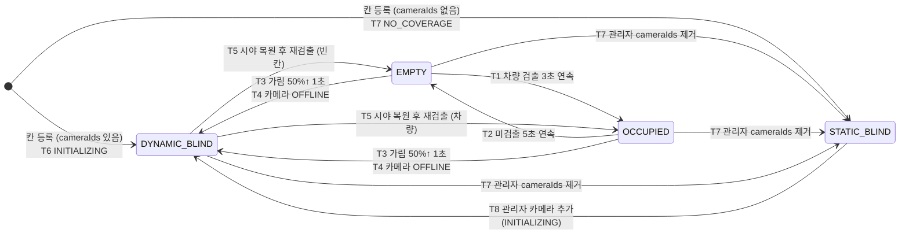

# 02. DB 스키마 설계 (2학기, 사각지대 대응)

- 작성일: 2026-10-07
- 기준: hun이 제시한 초안 + `01_기존구조_분석.md`의 분석 결과
- 상태: **설계안**. 실제 Firebase에는 반영하지 않았습니다.
- 샘플 데이터: `docs/sample_data.json` (주차장 1개, 층 1개, 카메라 2대, 주차칸 8개, 상태 4종 포함)
- 표기 규칙: **확인 필요** = 팀 결정이나 실측이 필요한 항목, **(추론)** = 근거는 있으나 검증하지 않은 해석

---

## 0. 초안 대비 수정 제안 요약

초안의 방향(칸 상태를 개별 문서로 분리, 미터 좌표, 카메라별 호모그래피, 이동 차량은 Realtime DB)은 그대로 유지합니다. 아래 9가지만 바꾸거나 추가하자고 제안합니다.

| # | 초안 | 제안 | 근거 |
| :--- | :--- | :--- | :--- |
| 1 | `polygon: [[x,y], ...]` | `polygon: [{x, y}, ...]` | Firestore는 **배열 안에 배열을 직접 넣을 수 없습니다**(nested array 미지원). 초안 형식은 저장 시 오류가 납니다 |
| 2 | spotId = `C1-3` (카메라-번호) | spotId = `{floorId}-{구역}-{번호}` (예: `B1-A-03`), 카메라는 `cameraIds` 필드로 연결 | (1) 한 칸을 여러 카메라가 볼 수 있음(고정 CCTV + 360도), (2) STATIC_BLIND 칸은 카메라가 없음, (3) 카메라 교체나 재배치 때 ID가 바뀌면 `users`의 내 차 위치와 즐겨찾기 등 참조가 깨짐 |
| 3 | 주차장 문서에 `floorPlanUrl`, `floorWidthM`, `floorHeightM` | `floors/{floorId}` 하위 컬렉션으로 이동 | 기존 데이터가 층(zones[]) 여러 개를 지원하고 앱도 층 스피너로 전환함 (`ParkingDetailActivity.java:207-229`) |
| 4 | 칸에 차종 타입 없음 | `type` 추가 (`NORMAL`, `COMPACT`, `EV`, `HANDICAP`, `PATRIOT`, `WOMAN`) | 앱의 자격 판정과 색상이 타입에 의존 (`ParkingMapView.java:242-262, 379-420`) |
| 5 | 주차장 문서에 집계 없음 | `summary` 필드 추가 (Cloud Functions가 계산) | 메인 지도는 주차장 전체를 한 번에 읽고 마커에 잔여 면수를 표시함 (`MainActivity.java:398-452`, `ParkingMarkerHelper.java:154-186`). 집계가 없으면 주차장마다 칸 문서를 전부 읽어야 함 |
| 6 | 기존 필드 일부 누락 | `category`, `feeType`, `ownerUid` 유지, `lat/lng` 대신 `location`(GeoPoint) | 마커 배지, 상세 화면, 관리자 권한 판정에 쓰임. GeoPoint는 기존 파싱 코드를 그대로 쓸 수 있음 (`ParkingSpot.java:63-67`) |
| 7 | 카메라당 `homography` 1개 | `views[]` 배열 안에 view별 `homography` | 360도 카메라의 원본 영상(등장방형)은 평면 투영이 아니라서 호모그래피 하나로 바닥을 변환할 수 없습니다. 원근 영상으로 잘라낸 view마다 호모그래피가 필요합니다 (추론, 엣지 구현 방식에 따라 **확인 필요**) |
| 8 | 칸에 상태 메타데이터 없음 | `statusSource`, `lastKnownStatus`, `blindReason`, `blindSince`, `confidence` 추가 | DYNAMIC_BLIND 동안 "가려지기 전 상태"를 보여주고, 원인(가림, 카메라 끊김, 초기화)을 구분하기 위함 |
| 9 | `tracks/{lotId}/{trackId}` | `tracks/{lotId}/{floorId}/{trackId}` | 앱은 현재 보고 있는 층만 구독하면 되므로 경로에 층을 넣으면 수신량이 줄어듦 |

추가로, 사용자의 "내 차 위치"는 칸 상태와 분리해서 `users/{uid}.myParking`에만 저장합니다. 1학기처럼 사용자가 칸 상태(`occupied`)를 직접 바꾸지 않습니다 (01 문서 3.6 참고).

---

## 1. 컬렉션별 필드 정의

### 1.0 전체 구조

```
Firestore
├── parkingLots/{lotId}                        주차장 (lotId는 기존 parkingspace 문서 ID 그대로 사용)
│   ├── floors/{floorId}                       층 (예: B1, B2)
│   ├── spots/{spotId}                         주차칸 (예: B1-A-03), 상태가 여기에 있음
│   └── cameras/{cameraId}                     카메라와 호모그래피 (관리자만 읽기)
├── users/{uid}                                사용자 (본인만 읽기/쓰기)
└── parkingspace/{id}                          기존 컬렉션 (이행 기간 동안 읽기 전용으로 유지 후 삭제)

Realtime Database
├── tracks/{lotId}/{floorId}/{trackId}         이동 차량 위치 (확장 모드)
├── edgeStatus/{lotId}/{cameraId}              카메라/엣지 생존 신호
└── myCar/{uid}                                (선택) 사용자가 지정한 내 차 trackId, 본인만 읽기
```

좌표계 공통 규칙: 단위 미터, 원점은 층 도면 이미지의 **왼쪽 위**, x는 오른쪽, y는 **아래쪽**(이미지 좌표와 같은 방향). 도면 이미지는 `[0, widthM] × [0, heightM]` 영역에 그대로 맞춰 그립니다. 방향 각도는 도(°), 0°는 +y가 아닌 **화면 위쪽(−y)**, 시계 방향 증가로 통일합니다 (**확인 필요**: 엣지 팀과 맞출 것).

### 1.1 `parkingLots/{lotId}`

| 필드 | 타입 | 필수 | 설명 | 예시 |
| :--- | :--- | :---: | :--- | :--- |
| `name` | string | O | 주차장 이름 | `"PARKIT 테스트 주차장"` |
| `address` | string | O | 도로명 주소 | `"서울특별시 중구 세종대로 110"` |
| `location` | GeoPoint | O | 위경도 (초안의 lat, lng) | `37.5665, 126.978` |
| `category` | string | O | `public` / `private` / `business` | `"public"` |
| `feeType` | string | O | `paid` / `free` / `conditional_free` (기존 오타 `conditional free`는 변환 시 정리) | `"paid"` |
| `ownerUid` | string | O | 관리자 Firebase Auth UID | `"admin_uid_demo"` |
| `extendedMode` | boolean | O | 360도 카메라 확장 모드 사용 여부 (앱이 tracks 구독 여부를 결정) | `true` |
| `summary` | map | O | 상태 집계 (1.1.1). **Cloud Functions만 씀** | 아래 참고 |
| `schemaVersion` | number | O | 스키마 버전, 이번 설계는 `2` | `2` |
| `updatedAt` | timestamp | O | 마지막 변경 시각 (serverTimestamp) | |

#### 1.1.1 `summary` 구조

```json
"summary": {
  "all":    { "total": 8, "empty": 4, "occupied": 2, "staticBlind": 1, "dynamicBlind": 1 },
  "byType": {
    "NORMAL": { "total": 4, "empty": 1, "occupied": 2, "staticBlind": 1, "dynamicBlind": 0 },
    "EV":     { "total": 1, "empty": 1, "occupied": 0, "staticBlind": 0, "dynamicBlind": 0 }
  },
  "updatedAt": "<timestamp>"
}
```

- 키는 칸 `type` 값을 그대로 씁니다. 기존 `parking_lots`의 `general/compact/electric/disabled/National/Female`처럼 이름이 달라 매핑이 필요한 문제를 없앱니다.
- 앱의 "남은 자리"는 `empty`만 셉니다. BLIND는 남은 자리에 넣지 않고 "확인 불가 N"으로 따로 보여줍니다 (3장).

### 1.2 `parkingLots/{lotId}/floors/{floorId}`

| 필드 | 타입 | 필수 | 설명 | 예시 |
| :--- | :--- | :---: | :--- | :--- |
| `name` | string | O | 표시 이름 | `"B1층"` |
| `order` | number | O | 층 정렬 순서 (기존 `created_at` 정렬 대체) | `1` |
| `planUrl` | string | O | 빈 도면 이미지 URL (기존 `bg_img_empty`, 초안의 `floorPlanUrl`) | `"https://.../B1_empty.png"` |
| `planImageWidthPx` | number | O | 도면 이미지 원본 가로 픽셀 | `2000` |
| `planImageHeightPx` | number | O | 도면 이미지 원본 세로 픽셀 | `1000` |
| `widthM` | number | O | 도면이 나타내는 실제 가로 길이 (초안의 `floorWidthM`) | `40.0` |
| `heightM` | number | O | 실제 세로 길이 (초안의 `floorHeightM`) | `20.0` |
| `spotOpacity` | number | X | 빈 칸 채우기 투명도 (기존 `spot_opacity`) | `0.6` |
| `updatedAt` | timestamp | O | | |

- `widthM / heightM`과 이미지 비율이 다르면 도면이 늘어나 보입니다. 관리자 웹에서 입력받을 때 비율을 검사하는 것을 권장합니다.
- `widthM`, `heightM`은 실측이나 설계 도면에서 가져와야 합니다 (**확인 필요**: 테스트 주차장의 실제 치수).

### 1.3 `parkingLots/{lotId}/spots/{spotId}`

spotId 규칙: `{floorId}-{구역}-{두 자리 번호}` (예: `B1-A-03`). 한 번 정하면 바꾸지 않습니다.

| 필드 | 타입 | 필수 | 설명 | 예시 |
| :--- | :--- | :---: | :--- | :--- |
| `label` | string | O | 화면에 보이는 칸 번호 | `"A-03"` |
| `floorId` | string | O | 소속 층. 앱은 `where("floorId", "==", 층)`으로 구독 | `"B1"` |
| `type` | string | O | `NORMAL` / `COMPACT` / `EV` / `HANDICAP` / `PATRIOT` / `WOMAN` | `"WOMAN"` |
| `polygon` | array<map{x,y}> | O | 칸 꼭짓점, 미터, 시계 방향 4개 이상 | `[{x:10,y:0},{x:12.5,y:0},{x:12.5,y:5},{x:10,y:5}]` |
| `center` | map{x,y} | O | 중심점 (아이콘 위치, 터치 판정 보조). polygon에서 계산해 저장 | `{x:11.25, y:2.5}` |
| `headingDeg` | number | X | 칸의 진입 방향 (차량 아이콘 방향) | `0` |
| `cameraIds` | array<string> | O | 이 칸을 볼 수 있는 카메라. 비어 있으면 STATIC_BLIND | `["CAM-01"]` |
| `primaryCameraId` | string \| null | O | 판정에 우선 사용하는 카메라 | `"CAM-01"` |
| `status` | string | O | `EMPTY` / `OCCUPIED` / `STATIC_BLIND` / `DYNAMIC_BLIND` | `"DYNAMIC_BLIND"` |
| `statusSource` | string | O | 상태를 정한 주체: `EDGE`(검출), `CONFIG`(설정상 사각), `ADMIN`(수동 보정), `LEGACY`(기존 데이터 이행) | `"EDGE"` |
| `confidence` | number \| null | X | 마지막 검출 신뢰도 0~1. BLIND이면 null | `0.94` |
| `lastKnownStatus` | string \| null | O | DYNAMIC_BLIND가 되기 직전의 EMPTY/OCCUPIED. 그 외 상태에서는 null | `"EMPTY"` |
| `blindReason` | string \| null | O | `NO_COVERAGE`(STATIC), `OCCLUDED`, `CAMERA_OFFLINE`, `INITIALIZING`(DYNAMIC). BLIND가 아니면 null | `"OCCLUDED"` |
| `blindSince` | timestamp \| null | O | BLIND 상태가 시작된 시각 | |
| `occludedByTrackId` | string \| null | X | 가린 차량의 trackId (확장 모드일 때만) | `"trk_0012"` |
| `legacySpotId` | string \| null | X | 기존 `zones[].spots[].id` (이행 추적용) | `"spot_1717800001000_0"` |
| `updatedAt` | timestamp | O | 마지막 상태 변경 시각 | |

- 엣지는 **상태가 바뀔 때만** 보고합니다(매 프레임 쓰기 금지). 칸마다 별도 문서이므로 1학기처럼 층 전체를 덮어쓰지 않습니다.
- 칸 크기는 더 이상 타입별 상수가 아니라 `polygon`으로 정해집니다. 앱의 `getSpotSpec()` 크기 상수(`ParkingMapView.java:379-420`)는 색상용으로만 남습니다.

### 1.4 `parkingLots/{lotId}/cameras/{cameraId}`

| 필드 | 타입 | 필수 | 설명 | 예시 |
| :--- | :--- | :---: | :--- | :--- |
| `name` | string | O | 카메라 이름 | `"B1 통로 360도 카메라"` |
| `floorId` | string | O | 설치 층 | `"B1"` |
| `kind` | string | O | `FIXED_CCTV` / `PANORAMA_360` | `"PANORAMA_360"` |
| `imageWidthPx`, `imageHeightPx` | number | O | 원본 영상 해상도 | `3840`, `1920` |
| `views` | array<map> | O | 판정/변환 단위. 고정 CCTV는 1개, 360도는 잘라낸 방향별로 여러 개 | 아래 |
| `views[].viewId` | string | O | view 이름 | `"south"` |
| `views[].yawDeg`, `views[].fovDeg` | number | 360도만 | 원근 변환한 방향과 화각 | `180`, `100` |
| `views[].homography` | array<number> (9개) | O | view 이미지 픽셀 → 도면 미터 변환 행렬, 행 우선, `h33 = 1`로 정규화 | `[0.0123, 0.0021, -1.5, ...]` |
| `status` | string | O | `ONLINE` / `OFFLINE` (Functions가 heartbeat로 갱신) | `"ONLINE"` |
| `lastHeartbeatAt` | timestamp | O | 마지막 생존 신호 | |
| `calibratedAt` | timestamp | O | 호모그래피 보정 시각 | |
| `updatedAt` | timestamp | O | | |

- 호모그래피는 카메라 설치 정보라 일반 사용자에게 공개하지 않습니다 (5장 규칙에서 관리자만 읽기).
- 칸과 카메라의 연결은 `spots.cameraIds`를 기준(단일 출처)으로 둡니다. 카메라 문서에 칸 목록을 중복 저장하지 않습니다.
- 엣지가 칸 판정에 쓰는 영상 내 ROI는 `polygon`을 호모그래피 역행렬로 영상 좌표로 바꿔 계산합니다 (추론). 역변환 결과가 부정확하면 view별 ROI를 따로 저장하는 필드가 필요할 수 있습니다 (**확인 필요**).

### 1.5 `users/{uid}`

| 필드 | 타입 | 필수 | 설명 | 예시 |
| :--- | :--- | :---: | :--- | :--- |
| `name`, `email` | string | O | 기존과 동일 | |
| `carInfo` | map<boolean> | O | 기존 5개 자격 필드 그대로 | `{isElectricCar: true, ...}` |
| `favorites` | array<string> | X | 즐겨찾기 lotId 목록. lotId를 기존 문서 ID로 유지하므로 **변환 불필요** | `["lot_demo_01"]` |
| `myParking` | map \| null | X | 내 차 위치. 기존 `parkedParkingId/parkedZoneName/parkedSpotId` 대체 | `{lotId, floorId, spotId, savedAt}` |

- `myParking`은 사용자 본인이 기록하는 정보이고 칸 `status`에는 영향을 주지 않습니다.
- STATIC_BLIND 칸에도 내 차 위치를 기록할 수 있게 하는 것을 제안합니다. 카메라가 못 보는 칸일수록 사용자가 직접 기록할 필요가 큽니다 (**확인 필요**).

### 1.6 Realtime Database `tracks/{lotId}/{floorId}/{trackId}`

| 필드 | 타입 | 필수 | 설명 | 예시 |
| :--- | :--- | :---: | :--- | :--- |
| `x`, `y` | number | O | 차량 바닥 접지점, 도면 미터 | `11.4`, `7.2` |
| `heading` | number | O | 진행 방향 (°) | `90.0` |
| `type` | string | O | `CAR` / `SUV` / `VAN` / `TRUCK` / `BUS` / `UNKNOWN` (아이콘과 DYNAMIC_BLIND 원인 판단) | `"TRUCK"` |
| `color` | string | X | 대표 색상 (`WHITE`, `BLACK`, ...). 내 차 식별 보조용 | `"WHITE"` |
| `lengthM`, `widthM` | number | X | 아이콘 크기 | `7.5`, `2.4` |
| `cameraId` | string | X | 주로 추적한 카메라 | `"CAM-02"` |
| `ts` | number | O | 엣지 기준 epoch 밀리초 | `1791342600000` |

- 번호판, 얼굴, 영상 조각은 저장하지 않습니다. trackId는 엣지가 임의로 붙이는 일회성 ID이고 차량을 장기간 식별하지 않습니다.
- 차량이 시야를 벗어나면 엣지가 해당 노드를 삭제합니다. 엣지가 비정상 종료돼 남은 노드는 앱이 `ts`가 10초 이상 지난 항목을 숨기고, 주기적인 Functions 작업으로 정리합니다 (**확인 필요**: 시간 기준).
- 갱신 주기는 차량당 초당 2~5회 정도를 권장합니다 (추론). 그보다 자주 쓰면 RTDB 대역폭이 커집니다.
- 이용자 본인 차량 표시 방법은 정해지지 않았습니다 (**확인 필요**). 개인정보 없이 가능한 안: 사용자가 앱에서 자기 차 아이콘을 탭해 지정하면 `myCar/{uid} = {lotId, floorId, trackId}`에 저장하고 본인만 읽게 함. trackId가 끊기면 다시 지정해야 하는 한계가 있습니다.

### 1.7 Realtime Database `edgeStatus/{lotId}/{cameraId}`

| 필드 | 타입 | 설명 |
| :--- | :--- | :--- |
| `online` | boolean | 엣지가 이 카메라 영상을 받고 있는지 |
| `fps` | number | 처리 프레임 속도 |
| `ts` | number | epoch 밀리초 |

Cloud Functions가 이 값을 보고 일정 시간 갱신이 없으면 카메라를 `OFFLINE`으로 바꾸고, 해당 카메라만 보던 칸을 `DYNAMIC_BLIND(CAMERA_OFFLINE)`으로 바꿉니다 (2장).

---

## 2. 상태 전이 규칙

### 2.1 상태 정의

| 상태 | 의미 | 누가 정하나 |
| :--- | :--- | :--- |
| `EMPTY` | 카메라가 보고 있고 차량이 없음 | 엣지 검출 |
| `OCCUPIED` | 카메라가 보고 있고 차량이 있음 | 엣지 검출 |
| `STATIC_BLIND` | 설치 구조상 어떤 카메라도 볼 수 없는 칸 (기둥 뒤, 화각 밖) | 관리자 설정 (`cameraIds`가 비어 있음) |
| `DYNAMIC_BLIND` | 원래는 보이지만 지금은 판정할 수 없음 (대형차 가림, 카메라 끊김, 시작 직후) | 엣지 또는 Functions |

### 2.2 전이 표

판정 기준값은 초기 제안이며 실험으로 조정합니다 (**확인 필요**).

| # | 현재 | 다음 | 조건 | 기록하는 필드 |
| :--- | :--- | :--- | :--- | :--- |
| T1 | EMPTY | OCCUPIED | 칸 ROI 안에서 차량 검출이 **3초 이상 연속** | `status`, `confidence`, `updatedAt` |
| T2 | OCCUPIED | EMPTY | 칸 ROI 안에서 차량 미검출이 **5초 이상 연속** (출차는 입차보다 보수적으로) | 위와 동일 |
| T3 | EMPTY / OCCUPIED | DYNAMIC_BLIND | 칸을 볼 수 있는 모든 카메라에서 ROI가 다른 객체(통로 차량, 사람 등)에 **50% 이상 가려진 상태가 1초 이상** | `lastKnownStatus` = 직전 상태, `blindReason=OCCLUDED`, `blindSince`, `occludedByTrackId`(가능하면) |
| T4 | EMPTY / OCCUPIED | DYNAMIC_BLIND | 칸을 볼 수 있는 모든 카메라가 OFFLINE (heartbeat 30초 이상 없음) | `blindReason=CAMERA_OFFLINE`, `lastKnownStatus` |
| T5 | DYNAMIC_BLIND | EMPTY / OCCUPIED | 가림이 해소되거나 카메라가 복구된 뒤 **재검출이 T1/T2 기준을 충족** | `lastKnownStatus=null`, `blindReason=null`, `blindSince=null` |
| T6 | (신규 칸) | DYNAMIC_BLIND | `cameraIds`가 있는 칸을 처음 등록하거나 엣지가 재시작된 직후 | `blindReason=INITIALIZING` |
| T7 | (신규 칸) 또는 아무 상태 | STATIC_BLIND | 관리자가 `cameraIds`를 비움 (카메라가 볼 수 없는 칸으로 설정) | `statusSource=CONFIG`, `blindReason=NO_COVERAGE` |
| T8 | STATIC_BLIND | DYNAMIC_BLIND | 관리자가 카메라를 추가해 `cameraIds`가 생김 → 첫 검출 전까지 INITIALIZING, 이후 T5로 확정 | `blindReason=INITIALIZING` |

규칙
- 엣지는 STATIC_BLIND로 바꾸거나 STATIC_BLIND에서 벗어나게 할 수 없습니다. STATIC_BLIND는 설정 변경(T7, T8)으로만 바뀝니다. Functions가 엣지 보고를 받을 때 이 규칙을 검사합니다.
- 칸을 여러 카메라가 볼 때는 **하나라도** 정상적으로 보고 있으면 BLIND가 아닙니다. 판정은 `primaryCameraId` 결과를 우선하고, 가려졌을 때 다른 카메라 결과로 대체합니다.
- DYNAMIC_BLIND가 오래 지속되면(예: 10분) 상태는 그대로 두고 관리자 웹에 경고를 띄웁니다. 앱은 `blindSince`로 "N분째 확인 불가"를 표시합니다.
- 확장 모드에서 차량 추적으로 STATIC_BLIND 칸의 입출차를 추정하는 기능은 이번 범위에 넣지 않습니다. 필요하면 `inferredStatus` 같은 별도 필드로 추가하고 `status`와 섞지 않는 것을 권장합니다.

### 2.3 상태도



### 2.4 쓰기 흐름

```
[엣지 Python] ──상태 변경분만 HTTPS──▶ [Cloud Functions: reportSpotStatus]
                                         ├─ 엣지 인증 확인 (lotId 범위)
                                         ├─ 전이 규칙 검사 (STATIC_BLIND 변경 거부 등)
                                         └─ spots/{spotId} 갱신 (Admin SDK)
[Cloud Functions: onSpotWrite 트리거] ──▶ parkingLots/{lotId}.summary 재계산
[엣지 Python] ──추적 좌표(초당 수 회)──▶ Realtime DB tracks/... (직접 쓰기, 5.2 참고)
[엣지 Python] ──heartbeat──▶ Realtime DB edgeStatus/... ──▶ [Functions 예약 작업] 카메라 OFFLINE 처리 (T4)
```

---

## 3. 앱에서의 상태별 표시

### 3.1 칸 표시 (상세 도면, `ParkingMapView`)

색만으로 구분하지 않고 패턴과 아이콘을 함께 씁니다 (색각 이상 사용자 고려).

| 상태 | 채우기 | 테두리 | 아이콘/패턴 | 비고 |
| :--- | :--- | :--- | :--- | :--- |
| EMPTY | 타입별 색 × `spotOpacity` (기존 유지) | 초록 `#38A169` 2dp | 타입 아이콘 (EV ⚡, 장애인 ♿ 등) | 1학기와 같은 느낌 유지 |
| OCCUPIED | 빨강 `#E53E3E` 45% | 빨강 `#E53E3E` 3dp | 위에서 본 차량 아이콘 | 기존 빨강 유지 (`ParkingMapView.java:333-342`) |
| STATIC_BLIND | 회색 `#718096` 25% | 회색 `#718096` 2dp | 촘촘한 빗금 + 눈 가림(👁 사선) 아이콘 | 항상 같은 모양. "카메라 사각지대" |
| DYNAMIC_BLIND | 주황 `#DD6B20` 20% | 주황 `#DD6B20` **점선** 2dp | 물음표 또는 시계 아이콘. `lastKnownStatus`가 OCCUPIED면 흐린 차량 아이콘을 겹쳐 그림 | 탭하면 "일시적으로 확인할 수 없음 (N분 전: 빈 칸)" |
| 내 차 (`users.myParking`) | 금색 `#FFC107` 30% | 금색 3dp | "내차" 글자 | 상태와 관계없이 최우선 (기존 유지) |
| 자격 미해당 | 기존 회색 빗금 | | | **주의**: STATIC_BLIND와 구분되도록 자격 미해당은 옅은 빗금 + 자물쇠 아이콘으로 변경 제안 |

우선순위: 내 차 > 자격 미해당 > STATIC_BLIND > DYNAMIC_BLIND > OCCUPIED > EMPTY. 도면 아래에 4가지 상태 범례를 추가합니다.

칸 선택(주차 위치 기록) 정책 제안: EMPTY와 STATIC_BLIND는 선택 가능, OCCUPIED는 "이미 차량이 있음" 경고 후 선택 가능(검출 오류 대비), DYNAMIC_BLIND는 선택 가능 (**확인 필요**).

### 3.2 지도 마커와 즐겨찾기 카드

- 숫자: `summary`에서 사용자 자격에 맞는 타입의 `empty` 합계. 기존처럼 비회원은 `NORMAL`만.
- BLIND 합계가 0보다 크면 마커 아래에 `확인불가 N` 작은 배지를 추가합니다.
- 잔여율 색 기준은 `empty / (total − staticBlind)`로 바꿉니다. 항상 안 보이는 칸을 분모에서 빼야 잔여율이 왜곡되지 않습니다.

### 3.3 확장 모드 (탑뷰 지도)

- 배경 도면 위에 칸 polygon을 3.1 규칙으로 그리고, `tracks`의 차량을 `type`별 아이콘으로 `(x, y)`, `heading` 방향에 그립니다. 영상은 합성하지 않습니다 (차량 모델링 방식).
- 내 차로 지정된 track은 파란 외곽선으로 강조합니다.
- `ts`가 10초 이상 지난 track은 그리지 않습니다.

---

## 4. 기존 DB → 새 DB 변환

### 4.1 ID 원칙

- **lotId = 기존 `parkingspace` 문서 ID 그대로.** 그래서 `users.favorites`는 변환하지 않아도 됩니다.
- floorId = 기존 `zones[].name`에서 만든 짧은 코드 (`"B1층"` → `B1`). 이름 규칙이 없는 경우 수동 지정 (**확인 필요**).
- spotId = 새 규칙 `B1-A-03`. 구역은 기존 `groups[].name`(`"A구역"` → `A`), 번호는 그룹 안에서 `localX` 순서. 기존 ID는 `legacySpotId`에 보관.

### 4.2 필드 매핑

| 기존 (`parkingspace/{id}`) | 새 위치 | 변환 |
| :--- | :--- | :--- |
| 문서 ID | `parkingLots/{lotId}` 문서 ID | 그대로 |
| `name` | `name` | 그대로 |
| (없음) | `address` | 관리자 입력 필요 (**확인 필요**) |
| `location` | `location` | 그대로 (GeoPoint) |
| `category` | `category` | 그대로 |
| `fee_type` | `feeType` | `"conditional free"` → `"conditional_free"`로 정리 |
| `owner_uid` | `ownerUid` | 그대로 |
| `parking_lots` | `summary` | **복사하지 않고** 변환 후 spots로부터 재계산 (기존 값은 앱이 갱신하지 않아 틀려 있을 수 있음, 01 문서 3.6) |
| `zones[i]` | `floors/{floorId}` | 1개 zone → 1개 floor 문서 |
| `zones[i].name` | `floors.name` | 그대로 |
| `zones[i].created_at` | `floors.order` | 생성 순서대로 1, 2, 3 |
| `zones[i].bg_img_empty` | `floors.planUrl` | 그대로 |
| `zones[i].bg_img_with_spots` | (삭제) | 새 구조에서는 칸을 데이터로 그리므로 불필요 |
| `zones[i].bg_scale_x/y`, `bg_pos_x/y` | 좌표 변환에만 사용 | 4.4 공식 |
| `zones[i].spot_opacity` | `floors.spotOpacity` | 그대로 |
| (없음) | `floors.widthM`, `heightM` | 관리자 실측 입력 필요 (**확인 필요**) |
| `zones[i].groups[]` | (삭제) | 칸 polygon 계산에만 사용 |
| `zones[i].spots[j]` | `spots/{spotId}` | 1개 spot → 1개 문서 |
| `spots[j].id` | `legacySpotId` | 보관 |
| `spots[j].type` | `type` | 그대로 |
| `spots[j].groupId`, `localX`, `localY` + 그룹 `x`, `y`, `rotation` + 타입별 크기 | `polygon`, `center`, `headingDeg` | 4.4 공식 |
| `spots[j].occupied` | `status` 외 | 4.3 규칙 |

| 기존 (`users/{uid}`) | 새 위치 | 변환 |
| :--- | :--- | :--- |
| `name`, `email`, `carInfo`, `favorites` | 같은 이름 | 그대로 |
| `parkedParkingId` | `myParking.lotId` | 그대로 |
| `parkedZoneName` | `myParking.floorId` | zone 이름 → floorId 매핑 |
| `parkedSpotId` | `myParking.spotId` | `legacySpotId`로 새 spotId를 찾아 바꿈 |
| (없음) | `myParking.savedAt` | 변환 시각 |

### 4.3 기존 Boolean(`occupied`) 처리

기존 `occupied`는 카메라 검출값이 아니라 **사용자가 직접 등록한 값**이었으므로 새 상태로 그대로 믿지 않습니다.

| 조건 | 새 `status` | `statusSource` | `lastKnownStatus` | `blindReason` |
| :--- | :--- | :--- | :--- | :--- |
| 칸을 볼 카메라가 없음 (`cameraIds` 비어 있음) | `STATIC_BLIND` | `CONFIG` | null | `NO_COVERAGE` |
| 카메라가 있고 `occupied == true` | `DYNAMIC_BLIND` | `LEGACY` | `OCCUPIED` | `INITIALIZING` |
| 카메라가 있고 `occupied == false` 또는 필드 없음 | `DYNAMIC_BLIND` | `LEGACY` | `EMPTY` | `INITIALIZING` |

- 엣지가 첫 판정을 보고하면 T5로 EMPTY/OCCUPIED가 확정됩니다.
- 엣지 없이 앱만 테스트할 때는 변환 스크립트 옵션으로 `true → OCCUPIED`, `false → EMPTY`를 바로 넣을 수 있게 합니다 (`statusSource=LEGACY`).
- 칸과 카메라의 연결(`cameraIds`)은 기존 데이터에 없으므로 변환 전에 관리자가 정해야 합니다 (**확인 필요**). 정해지지 않은 칸은 일단 STATIC_BLIND로 둡니다.

### 4.4 픽셀 → 미터 좌표 변환 공식

기존 칸은 관리자 웹 Konva 스테이지의 픽셀 좌표이고, 칸의 중심을 기준으로 그룹 회전만큼 돌려서 그립니다 (`ParkingMapView.java:264-281`). 같은 방식으로 꼭짓점을 구한 뒤 미터로 바꿉니다.

```
입력: group(x, y, rotation), spot(localX, localY, type), 타입별 크기(w, h) = SPOT_TYPES[type]
     zone(bg_pos_x, bg_pos_y, bg_scale_x, bg_scale_y), 이미지 원본 크기(Wimg, Himg), floor(widthM, heightM)

1) 칸 중심 (스테이지 픽셀)
   θ  = rotation × π / 180
   cx = localX + w/2,  cy = localY + h/2
   Cx = group.x + (cx·cosθ − cy·sinθ)
   Cy = group.y + (cx·sinθ + cy·cosθ)

2) 꼭짓점 4개 (스테이지 픽셀)
   (dx, dy) ∈ {(−w/2, −h/2), (w/2, −h/2), (w/2, h/2), (−w/2, h/2)}
   Px = Cx + (dx·cosθ − dy·sinθ)
   Py = Cy + (dx·sinθ + dy·cosθ)

3) 스테이지 픽셀 → 미터
   x_m = (Px − bg_pos_x) / (Wimg × bg_scale_x) × widthM
   y_m = (Py − bg_pos_y) / (Himg × bg_scale_y) × heightM

4) center = (Cx, Cy)를 3)으로 변환, headingDeg = rotation
```

- 기존 칸 크기(일반 40×80 픽셀)는 도면 축척과 무관한 상수였으므로, 변환하면 실제 크기와 맞지 않을 수 있습니다. 변환 후 관리자 웹에서 칸 크기를 실제 규격(일반형 2.5m × 5.0m 등)에 맞게 다시 조정하는 단계가 필요합니다 (**확인 필요**).

### 4.5 변환 절차

1. 기존 Firestore 내보내기 (백업)
2. 변환 스크립트(Node.js, Admin SDK)를 **dry-run**으로 실행해 새 구조를 JSON 파일로만 출력하고 `sample_data.json`과 같은 형식인지 검토
3. 관리자가 floor 실측값(`widthM`, `heightM`), 칸-카메라 연결(`cameraIds`), 주소를 채움
4. 개발용 Firebase 프로젝트(또는 Emulator)에 먼저 반영해 앱과 관리자 웹 확인
5. 운영 프로젝트에 반영. 이행 기간 동안 `parkingspace`는 읽기 전용으로 유지 (보안 규칙으로 쓰기 차단)
6. 모든 클라이언트 전환 확인 후 `parkingspace` 삭제

---

## 5. 보안 규칙 초안

전제
- Cloud Functions와 변환 스크립트는 Admin SDK(서비스 계정)를 쓰므로 **보안 규칙의 영향을 받지 않습니다.** 그래서 "쓰기는 Functions만"은 규칙에서 `allow write: if false`로 표현합니다.
- 1학기 앱은 비회원도 지도를 볼 수 있으므로(`AndroidManifest.xml:32` 주석, `UserCarInfo.getGuest()`) 주차장, 층, 칸은 로그인 없이 읽기를 허용합니다. 비회원 공개 여부는 **확인 필요**.
- 요청하신 "앱은 읽기만"에서 `users/{uid}`는 예외로 둡니다. 즐겨찾기, 차량 정보, 내 차 위치는 사용자 본인이 써야 하기 때문입니다. 이 쓰기도 Functions로 옮길 수는 있지만 이득이 적다고 판단했습니다.
- 관리자 웹도 지금은 `parkingspace`를 직접 수정합니다(`App.js:820, 910, 1130`). 아래 규칙을 적용하면 관리자 웹의 도면 편집은 Callable Function(예: `upsertFloorLayout`)을 통해야 합니다.

### 5.1 Firestore (`firestore.rules`)

```
rules_version = '2';
service cloud.firestore {
  match /databases/{database}/documents {

    function signedIn() {
      return request.auth != null;
    }
    // 관리자: 커스텀 클레임 admin == true 이고 해당 주차장의 소유자
    function isLotAdmin(lotId) {
      return signedIn()
        && request.auth.token.admin == true
        && get(/databases/$(database)/documents/parkingLots/$(lotId)).data.ownerUid == request.auth.uid;
    }

    match /parkingLots/{lotId} {
      allow read: if true;            // 비회원 지도 조회 허용 (확인 필요)
      allow write: if false;          // Cloud Functions(Admin SDK)만

      match /floors/{floorId} {
        allow read: if true;
        allow write: if false;
      }
      match /spots/{spotId} {
        allow read: if true;
        allow write: if false;
      }
      match /cameras/{cameraId} {
        allow read: if isLotAdmin(lotId);   // 호모그래피 등 설치 정보는 관리자만
        allow write: if false;
      }
    }

    match /users/{uid} {
      allow read: if signedIn() && request.auth.uid == uid;
      allow create, update: if signedIn() && request.auth.uid == uid
        && request.resource.data.keys().hasOnly(['name', 'email', 'carInfo', 'favorites', 'myParking'])
        && (!('myParking' in request.resource.data)
            || request.resource.data.myParking == null
            || request.resource.data.myParking.keys().hasOnly(['lotId', 'floorId', 'spotId', 'savedAt']));
      allow delete: if false;
    }

    // 이행 기간: 기존 컬렉션은 읽기 전용
    match /parkingspace/{id} {
      allow read: if true;
      allow write: if false;
    }

    // 그 외 모든 경로 차단
    match /{document=**} {
      allow read, write: if false;
    }
  }
}
```

### 5.2 Realtime Database (`database.rules.json`)

엣지의 추적 좌표는 초당 여러 번 갱신되므로 Functions를 거치면 지연과 비용이 커집니다. 그래서 추적 좌표만은 **엣지 전용 계정**이 직접 쓰게 하는 것을 제안합니다. 엣지 기기는 Functions가 발급한 커스텀 토큰으로 로그인하고, 토큰에 `edge: true`, `lotId` 클레임을 넣어 자기 주차장 경로에만 쓸 수 있게 합니다. 엣지에 서비스 계정 키 파일을 두는 방식보다 노출 범위가 작습니다. 요청하신 "Functions만 쓰기"를 RTDB에도 그대로 적용할지는 **확인 필요**입니다.

```json
{
  "rules": {
    "tracks": {
      "$lotId": {
        ".read": "auth != null",
        ".write": "auth != null && auth.token.edge === true && auth.token.lotId === $lotId",
        "$floorId": {
          "$trackId": {
            ".validate": "newData.hasChildren(['x', 'y', 'heading', 'type', 'ts']) && newData.child('x').isNumber() && newData.child('y').isNumber() && newData.child('ts').isNumber()",
            "plate": { ".validate": false }
          }
        }
      }
    },
    "edgeStatus": {
      "$lotId": {
        ".read": "auth != null && auth.token.admin === true",
        ".write": "auth != null && auth.token.edge === true && auth.token.lotId === $lotId"
      }
    },
    "myCar": {
      "$uid": {
        ".read": "auth != null && auth.uid === $uid",
        ".write": "auth != null && auth.uid === $uid"
      }
    }
  }
}
```

- `tracks` 읽기를 로그인 사용자로 제한했습니다. 실시간 차량 이동 정보는 번호판이 없어도 공개 범위를 좁히는 편이 안전합니다. 비회원에게도 확장 모드를 보여주려면 익명 로그인(Anonymous Auth)을 쓰면 됩니다.
- `plate` 같은 개인정보 필드는 규칙에서 거부해 실수로 저장되지 않게 했습니다.

---

## 6. 샘플 데이터

`docs/sample_data.json`

- 주차장 `lot_demo_01` 1개, 층 `B1` 1개 (40m × 20m)
- 카메라 2대: `CAM-01` 고정 CCTV (view 1개), `CAM-02` 360도 (view 2개)
- 주차칸 8개와 상태
  | spotId | 타입 | 상태 | 비고 |
  | :--- | :--- | :--- | :--- |
  | B1-A-01 | NORMAL | EMPTY | |
  | B1-A-02 | NORMAL | OCCUPIED | |
  | B1-A-03 | WOMAN | DYNAMIC_BLIND | 트럭 `trk_0012`에 가림, 직전 상태 EMPTY |
  | B1-A-04 | EV | EMPTY | 카메라 2대가 동시에 봄 |
  | B1-B-01 | NORMAL | OCCUPIED | 사용자 `user_uid_demo`의 내 차 위치 |
  | B1-B-02 | COMPACT | EMPTY | |
  | B1-B-03 | HANDICAP | EMPTY | |
  | B1-B-04 | NORMAL | STATIC_BLIND | 기둥 뒤, `cameraIds` 비어 있음 |
- `summary` 값은 8개 칸 상태로 계산한 값과 일치하는지 스크립트로 확인했습니다 (EMPTY 4, OCCUPIED 2, STATIC_BLIND 1, DYNAMIC_BLIND 1).
- Firestore 영역에 배열 안의 배열이 없는지 확인했습니다.
- RTDB 영역에 `tracks` 2대(트럭, 승용차)와 `edgeStatus` 예시를 넣었습니다.
- Timestamp는 ISO 문자열, GeoPoint는 `{latitude, longitude}`로 표기했습니다. Emulator에 넣을 때는 변환 스크립트에서 타입을 바꿔야 합니다.

---

## 7. 결정이 필요한 항목

| # | 항목 | 제안 |
| :--- | :--- | :--- |
| 1 | 비회원에게 주차장/칸 정보를 공개할지 | 공개 (1학기와 동일) |
| 2 | RTDB 추적 좌표를 엣지가 직접 쓸지, Functions를 거칠지 | 엣지 전용 커스텀 토큰으로 직접 쓰기 |
| 3 | 판정 기준값 (입차 3초, 출차 5초, 가림 50%/1초, 카메라 끊김 30초) | 실험 후 조정 |
| 4 | 이용자 본인 차량 식별 방법 | 앱에서 아이콘 탭으로 지정 (`myCar/{uid}`) |
| 5 | 360도 카메라 처리 방식 (view 분할 여부) | 엣지 구현 방식 확인 후 `views[]` 구조 확정 |
| 6 | 테스트 주차장 실측 치수와 칸-카메라 연결 | 현장 측정 필요 |
| 7 | 방향 각도 기준 (0° = 화면 위, 시계 방향) | 엣지 팀과 합의 |
