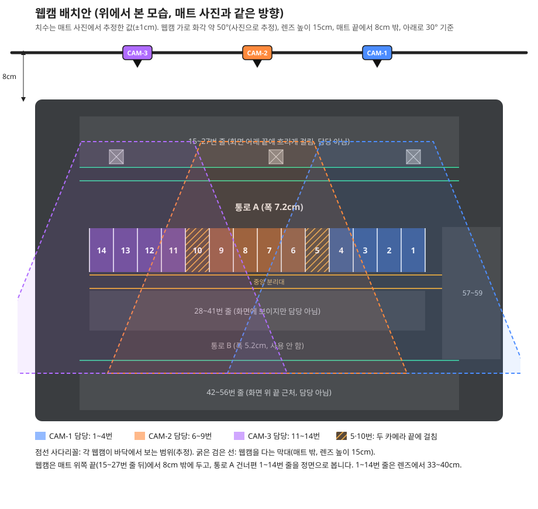
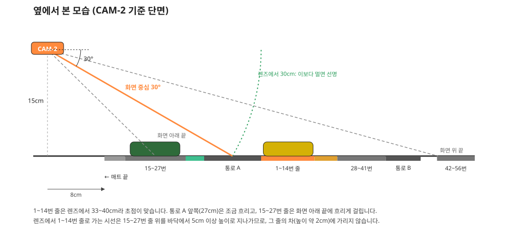

# 11. 웹캠 위치와 각도 (2026-10-25 작성, 2026-11-01 웹캠 2대로 변경)

주차장 매트(78.3 × 55.4cm, 2절 실측)에 웹캠의 위치, 높이, 각도를 정한다. 학습 사진(10 문서)도 이 위치에서 찍는다.

> 2026-11-01 변경: 웹캠을 3대에서 **2대**로 줄였다. **먼저 1대로** 판정이 되는지 확인하고, 최종 시연은 2대로 한다. 감시하는 칸도 1~14번 줄로 고정하지 않고, 카메라에 보이는 칸이면 어느 줄이든 감시할 수 있게 한다(22 문서). 아래 수치는 2절 실측 치수로 다시 계산했다. 위 그림(svg)은 3대 배치 때 그린 것이라 웹캠 위치가 다르다.

처음 안(렌즈 높이 12cm, 보도 위, 아래로 50°)은 담당 칸이 렌즈에서 17~23cm라, 고정 초점 웹캠으로 찍은 거리별 사진(3절)에서 흐린 거리였다. 그래서 웹캠을 매트 밖으로 물려 담당 칸이 렌즈에서 30cm 넘게 떨어지도록 바꿨다.





## 1. 정한 것

| 항목 | 추천 | 비고 |
|---|---|---|
| 웹캠 수 | **시험 1대 → 최종 시연 2대** | 1대로 판정이 되는지 먼저 확인 |
| 웹캠 자리 | 매트 위쪽 끝(15~27번 줄 쪽)에서 **8cm 밖** | 매트 밖이라 막대 받침도 쉽다 |
| 가로 위치 | CAM-1: **4번 칸 가운데 맞은편**(x 약 51cm) / CAM-2: **11번 칸 가운데 맞은편**(x 약 23cm) | 간격 약 28cm(7칸). 1대 시험은 CAM-1 자리에서 |
| 높이 | 매트 표면에서 **렌즈까지 15cm** | 실제 환산 약 9.6m |
| 아래 각도 | 수평에서 **아래로 30°** (28~33° 사이에서 조정) | 화면 위 끝이 42~56번 줄 입구 근처에 온다 |
| 좌우 방향 | 1~14번 줄을 **정면**으로 (비틀지 않음) | |
| 감시할 수 있는 칸 (계산) | CAM-1: **1~7번, 34~41번** / CAM-2: **8~14번, 28~35번** | 34·35번은 두 대가 함께 본다(겹침 시험 S6에 쓸 수 있음) |
| 감시 못 하는 칸 | 15~27번(화면 아래 끝에 입구만 걸림), 42~56번(화면 위 끝에 입구만 걸림), 57~59번 | STATIC_BLIND. 기둥 사각지대(S3) 시연에 쓴다 |

- 감시할 칸은 코드에 고정하지 않는다. 보정할 때 카메라마다 화면에 들어온 칸을 고르고 설정 파일에 저장한다(22 문서 3절).
- 2대면 1~14번 줄은 빈틈 없이 나눠 본다. 예전 3대 배치의 "카메라 사이 사각지대(5·10번)"는 없어지고, 사각지대 시연은 15~27번·42~56번 줄과 기둥으로 한다.
- 28~41번 줄은 1~14번 줄 뒤에 있어서, 같은 줄에 선 1~14번 차가 28~41번 차의 바닥 쪽을 가릴 수 있다(4절 계산). 1대 시험에서 꼭 확인한다.

**대안**: 막대를 매트 끝 바로 위에 두려면 렌즈 높이 **20cm, 아래로 38~42°** 로 한다. 1~14번 줄이 렌즈에서 약 30~36cm가 되어 초점은 맞지만 30cm 경계에 걸리고, 위에서 내려다보는 모습에 가까워진다(예전 치수로 계산).

## 2. 매트 치수 (2026-10-31 hun 실측)

기준: 15~27번 줄을 위로 두고 본다. 세로(y)는 15~27번 줄 쪽 매트 끝에서, 가로(x)는 왼쪽 매트 끝에서 잰 거리(cm)다.

| 부분 | 실측 | 실제 환산(×64) |
|---|---|---|
| 매트 전체 | 78.3 × 55.4cm | |
| 칸 깊이(카스토퍼 ~ U자 끝) | 6.7cm | 약 4.3m |
| 칸 간격 | 14칸 56.4cm → 칸당 약 4.03cm | 약 2.6m |
| 차가 들어가는 빈 공간 | 3.1cm | 약 2.0m |
| U자 선 폭(선 포함) | 약 0.9cm | |
| 통로 A 폭 | 7.2cm | 약 4.6m |
| 통로 B 폭 | 5.2cm | 약 3.3m |
| 보도(초록 선 포함) | 약 2.6cm | |
| 중앙 분리대(선 포함) | 약 2.2cm | |
| 미니카 | 길이 약 7cm, 폭 약 3.2cm (추정) | 약 4.5 × 2m |

세로 위치(y): 15~27번 줄 2.8~9.5, 보도 A 9.9~12.5, 통로 A 12.5~19.7, 1~14번 줄 19.7~26.4(입구 U자 끝 19.7, 카스토퍼 26.4), 중앙 분리대 27.6~29.8, 28~41번 줄 31~37.7(2026-11-04 고침, 처음 받은 값 37.6), 통로 B 37.6~42.9, 보도 B 42.9~45.5, 42~56번 줄 46~52.7(2026-11-03 고침, 처음 받은 값 45.8).

가로 위치(x): 1~14번 줄과 28~41번 줄은 같은 위치다. 14번(28번) 칸 왼쪽은 U자가 반만 그려져 있고, 그 칸의 빈 공간이 9.5에서 시작한다. 1번(41번) 칸 오른쪽 U자 바깥 끝은 65.9(9.5 + 56.4)다.

15~27번, 42~56번 줄은 기둥 때문에 칸 간격이 일정하지 않다. 이 두 줄의 가로 위치는 처음에 10/31 사진에서 추정했고(±0.3cm), 2026-11-03에 기둥으로 나뉜 묶음마다 실측한 값으로 바꿨다(30 문서 5절). 사진 추정과는 최대 0.3cm(56번 칸) 달랐다. 칸별 좌표는 `docs\칸표_매트좌표_초안.json`, 그림은 `docs\그림\24_매트_칸_오버레이.png`.

1절과 4절의 거리는 이 실측 치수로 계산했다(2026-11-01).

## 3. 웹캠 초점과 화각 (거리별 사진으로 측정)

웹캠을 바닥에 놓고 앞으로 10~50cm에 미니카를 두고 찍은 사진 5장(`dataset/10cm.jpg`~`50cm.jpg`)을 봤다.

- **고정 초점**이다. 설정 창에서 Focus 항목이 비활성이다.
- 매트 흰 선의 경계가 번지는 폭(밝기가 10%에서 90%로 바뀌는 데 걸리는 픽셀 수)을 거리별로 쟀다.

| 렌즈에서 거리 | 경계 번짐 폭 | 차 사진 |
|---|---|---|
| 12~13cm | 10~12픽셀 | 10cm: 많이 흐림 |
| 15~19cm | 8~10픽셀 | 20cm: 흐림 |
| 27~29cm | 6~7픽셀 | 30cm: 조금 흐림 |
| 31~34cm | 4~5픽셀 | 40·50cm: 가장 선명 |

- 결론: **30cm부터 선명해지고 40~50cm가 가장 선명**하다. 눈으로 본 판단과 같다. 그래서 담당 칸(1~14번 줄)이 렌즈에서 30cm 넘게 떨어지도록 배치했다.
- **가로 화각은 약 50~55°** 로 추정된다. 같은 사진에서 미니카 폭(약 3.2cm로 가정)이 1280 화면에서 20cm일 때 약 215픽셀, 50cm일 때 약 90픽셀이었다. 처음 가정한 70°보다 좁다. 아래 계산은 50°로 했다.

## 4. 왜 이렇게 정했나

### 통로 A를 고른 이유

- 통로 A가 7.2cm로 통로 B(5.2cm)보다 넓다. 차가 지나가는 장면(S7)과 큰 차가 칸을 가리는 장면(S4)을 만들기 쉽다.
- 15~27번 줄 쪽이 매트 가장자리라, 웹캠 막대를 매트 밖에 둘 수 있다. 1~14번 줄 쪽에서 보려면 매트 한가운데(중앙 분리대)에 받침을 세워야 한다.
- 실제 지하주차장 CCTV처럼 통로 건너편에서 주차된 차의 앞(또는 뒤)과 지붕을 비스듬히 본다. 바로 위에서 지붕만 보는 모습은 기본 모델의 학습 사진에 드물어 인식이 약하다(05 문서 4.1절, 추론).

### 높이 15cm, 매트 밖 8cm, 아래로 30°에서 보이는 범위 (계산값, 2026-11-01 실측 치수)

가로 화각 50°, 1920×1080 화면으로 계산했다.

| 바닥 위치 (매트 위쪽 끝에서) | 렌즈에서 거리 | 화면 세로 위치 (1080 중, 위가 0) | 보이는 폭 | 미니카 폭 |
|---|---|---|---|---|
| 7.2cm (화면 아래 끝) | 21cm | 1080 | 약 19cm | |
| 9.5cm (15~27번 줄 입구) | 23cm | 약 925 | 약 21cm, 5칸 | 약 290픽셀 |
| 12.5cm (통로 A 앞쪽) | 25cm | 약 765 | 약 24cm, 6칸 | 약 260픽셀 |
| 19.7cm (1~14번 줄 입구) | 31.5cm | 약 485 | 약 29cm, 7.3칸 | 약 210픽셀 |
| 26.4cm (1~14번 줄 카스토퍼) | 37.5cm | 약 310 | 약 35cm, 8.6칸 | 약 175픽셀 |
| 31cm (28~41번 줄 카스토퍼) | 42cm | 약 215 | 약 38cm, 9.6칸 | 약 160픽셀 |
| 37.7cm (28~41번 줄 입구) | 48cm | 약 110 | 약 44cm, 11칸 | 약 140픽셀 |
| 46.8cm (화면 위 끝, 42~56번 줄 입구) | 57cm | 0 | 약 51cm | |

- 1~14번 줄은 화면 가운데 위(세로 310~485), 28~41번 줄은 그 위(110~215)에 들어온다. 통로 A는 화면 아래 절반이다.
- 15~27번 줄은 화면 아래 끝에 입구만 걸리고 렌즈에서 23cm라 흐리다. 42~56번 줄도 화면 위 끝에 입구만 걸린다. 그래서 이 배치에서는 두 줄을 감시하지 않는다.
- 미니카가 1920 화면에서 140~210픽셀이라, 화면 전체를 YOLO 입력 640으로 줄여도 47~70픽셀이다. 07 문서에서 못 잡은 40픽셀보다 크다.
- 렌즈에서 1~14번 줄로 가는 시선은 15~27번 줄 위를 바닥에서 5cm 이상 높이로 지나간다. 그 줄의 차(높이 약 2cm)에 가리지 않는다.
- **28~41번 줄 가림:** 렌즈에서 28~41번 카스토퍼(31cm)로 가는 시선은 1~14번 카스토퍼(26.4cm) 위를 바닥에서 약 1.8cm 높이로 지난다. 미니카 높이(약 2cm)보다 낮아서, 1~14번 줄에 같은 가로 위치로 선 차가 28~41번 차의 앞 바닥 부분을 가릴 수 있다. 판정은 차 상자 아래 변을 쓰므로 영향을 받을 수 있다(22 문서 4.1).
- 화면 위쪽 양 끝에는 매트 밖 책상이 조금 보일 수 있다. 판정에는 영향이 없지만 책상 위 물건은 치운다.

### 높이 20cm (완화 조건) 비교

막대를 매트 끝 바로 위로 옮기고 렌즈를 20cm, 아래로 약 40°로 두면, 1~14번 줄이 렌즈에서 30~36cm, 한 대가 줄에서 7~8칸을 보고 미니카는 약 125~150픽셀이 된다. 가림이 줄어 판정은 쉬워지지만 위에서 내려다보는 모습에 가까워진다. 05 문서 3.2절처럼 두 높이를 모두 측정하려면 막대 높이만 바꾸고 기준점 보정을 따로 저장한다.

## 5. 화면 일부만 분석해야 할까 (ROI)

카메라를 물리면서 한 화면에 담기는 범위가 넓어지고 차는 작아진다. 정리하면 이렇다.

- **저장(`capture.py`)은 화면 전체를, 웹캠이 지원하는 가장 큰 해상도로** 한다. 나중에 잘라 쓰는 것은 언제든 되지만, 작게 찍은 것을 키울 수는 없다. `ffmpeg -list_options`로 확인한 이 웹캠의 최대는 **MJPEG 1920×1080, 30fps**다(광고의 500만 화소 모드는 없다). 그래서 `capture.py --width 1920 --height 1080`으로 찍는다.
  - 같은 자리에서 세 해상도로 찍어 비교했다(2026-10-25). 1920×1080과 1280×720은 **같은 범위**를 본다. 640×480은 4:3이라 **양옆이 잘려** 가로 범위가 약 3/4로 줄어드므로 쓰지 않는다.
  - 1920×1080은 1280×720을 단순히 늘린 화면은 아니고 실제 세부가 조금 더 있다. 다만 1.5배만큼 선명하지는 않다(차 사진을 확대해 비교한 결과). 파일이 조금 커지는 것 말고는 손해가 없어 1920×1080을 쓴다.
  - 1920×1080이면 위 표의 미니카 폭은 1.5배(165~195픽셀)가 된다.
- **분석(`live_detect.py`)은 먼저 화면 전체를 640으로** 해 본다. 1~14번 줄 차가 약 60~70픽셀, 28~41번 줄 차가 약 47~53픽셀이라 잡힐 가능성이 높다. 감시 칸 밖에서 잡힌 차는 바닥 접점 판정에서 어차피 버려진다.
- 시험해서 먼 줄(28~41번)의 차를 놓치면, **감시 칸이 있는 화면 위쪽 절반만 잘라** 분석하는 방법을 쓴다. 세로 약 60~560 정도만 잘라 640으로 넣으면 차가 커진다. 계산량은 그대로라 05 문서의 1순위(계산 부담)도 지킨다.
- 잘라서 분석하기로 하면 **학습 사진도 같은 방식으로 잘라서** 학습해야 차 크기가 맞는다. 자르지 않을 거면 학습 때 `imgsz`를 960~1280으로 키우는 방법도 있다.
- 잘라서 키우는 것(디지털 줌)은 **원본 해상도가 클수록** 효과가 크다. 1920×1080으로 받아서 자르면, 같은 범위를 1280×720에서 자를 때보다 잘린 사진에 실제 화소가 1.5배 많아 더 또렷하다. 흐린 것을 선명하게 만들지는 못하므로, 초점 거리(30cm 이상)는 지켜야 한다.

## 6. 현장에서 맞추는 순서

1. **매트를 판에 펴서 고정**한다(10 문서 4절). 고정 후에 카메라를 맞춘다.
2. **웹캠 한 대로 먼저 확인**한다. 책이나 상자를 쌓아 매트 위쪽 끝에서 8cm 밖, 렌즈 높이 15cm에 두고, `capture.py`로 화면을 띄운다.
   - **초점**: 1~14번 줄에 세운 미니카의 글씨와 바퀴 경계가 선명한지 본다. 흐리면 웹캠을 2~3cm 더 뒤로 물린다.
   - **화각**: 1~14번 줄 입구에서 7칸 남짓, 28~41번 줄 입구에서 11칸쯤 보이면 계산과 같다.
3. **각도 맞추기**: 28~41번 줄 입구가 화면 위쪽 1/10쯤, 1~14번 줄이 화면 가운데 위에 오도록 아래 각도를 조정한다. 휴대폰 각도계 앱을 웹캠 윗면에 대면 각도를 잴 수 있다.
4. **막대 만들기**: 매트보다 긴 막대(약 90~100cm, 각재나 알루미늄 프로파일)를 매트 위쪽 끝에서 8cm 밖, 양쪽 받침 위에 올린다. 웹캠을 1절 가로 위치(CAM-1, CAM-2)에 볼헤드로 단다. 1대 시험 때는 CAM-1 자리만 쓴다.
5. **위치 고정과 기록**: 막대와 받침 위치를 테이프로 표시하고, 실제 높이, 매트 끝까지 거리, 각도를 이 문서 1절에 적는다. 카메라가 1mm만 밀려도 호모그래피가 바뀐다(05 문서).
6. **조명**: 막대와 웹캠의 그림자가 감시 칸에 떨어지지 않게 조명을 막대 반대쪽(28~41번 줄 쪽 위)에 둔다.
7. **노출**: 설정 창에서 Exposure의 Auto를 끄고 값을 고정한다. 자동이면 차가 들어올 때마다 밝기가 바뀐다.

## 7. 학습 사진 찍을 때

- CAM-1, CAM-2 자리에서 각각 찍는다. 2대를 모두 꽂았다면 `capture.py --cam 0 --prefix C1`처럼 카메라마다 번호와 앞부분을 바꿔 실행한다.
- 시연 중 카메라가 조금 밀려도 버티도록, 전체의 20% 정도는 높이 ±1cm, 각도 ±3° 정도 바꿔서 찍는다.
- 주차된 차는 1~14번 줄과 28~41번 줄에, 움직이는 차와 큰 차는 통로 A에 둔다. 28~41번 줄은 감시 칸이 되었으므로, 1~14번 차에 일부가 가려진 장면도 찍는다.
- 화면 아래 끝 15~27번 줄의 흐린 차도 보이면 라벨을 단다. 라벨을 빼면 모델이 "흐린 차는 차가 아니다"라고 배운다.
- 20cm 완화 조건도 측정할 계획이면 그 높이에서도 따로 찍는다.

## 8. 가정과 확인할 것

- 가로 화각 약 50°는 미니카 폭을 3.2cm로 놓고 사진에서 추정한 값이다. 6절 2번에서 보이는 칸 수로 다시 확인한다.
- 매트의 기둥(15~27번 줄의 X 표시)은 인쇄된 그림이다. 이 배치에서는 기둥이 웹캠 앞 아래쪽에 있으므로, 그 위에 높은 기둥 모형을 세우면 통로 A 앞쪽을 가린다. 기둥으로 가리는 장면(S3)이 꼭 필요하면 1~14번 줄 입구의 칸 경계선 위에 1cm 각재 기둥을 세운다. 비스듬히 보는 카메라에서는 그 뒤 칸의 일부가 가려진다.

## 9. 웹캠 거치대 만들기 (2026-10-26)

6절 4번의 "막대"를 구체적으로 정한다. 조건은 두 대가 **같은 높이(렌즈 15cm), 같은 각도(아래로 30°), 약 28cm 간격**(1절 가로 위치)으로 서고, 손이나 케이블에 닿아도 밀리지 않는 것이다.

### 추천: 막대 하나에 미니 볼헤드 두 개

```
        [CAM-2]             [CAM-1]        ← 웹캠 (1/4인치 나사홈), 15~27번 줄 쪽에서 매트를 볼 때
          ●                   ●            ← 미니 볼헤드 (각도 30°로 잠금)
 ┌───────┴───────────────────┴───────┐    ← 가로 막대 약 90~100cm
 │                                │
 ▌받침                        받침▐     ← 매트를 고정한 판에 나사로 고정
```

| 부품 | 수량 | 예상 가격(확인 필요) | 비고 |
|---|---|---|---|
| 각재(30×30mm 정도) 100cm | 1 | 3천~5천원 | 철물점·온라인 재단. 휘지 않는 곧은 것 |
| 받침용 각재 토막 또는 ㄱ자 꺾쇠 | 2 | 2천~4천원 | 막대 높이를 맞추는 다리 |
| 미니 볼헤드(1/4인치 수나사, 아래 1/4인치 암나사) | 2 | 개당 3천~6천원 | "미니 볼헤드" "핫슈 볼헤드"로 검색 |
| 1/4인치(1/4-20 UNC) 카메라 나사 + 와셔 | 2 | 개당 500~1천원 | **M6 볼트가 아니다.** 나사산이 달라 안 맞는다 |
| 케이블 타이, 양면 폼테이프 | 조금 | 2천원 | USB 선을 막대에 묶는다 |

합계 약 2~3만원(웹캠 제외). 가격은 온라인 검색 기준 추정이라 실제 주문 때 확인한다.

**만드는 법**

1. 막대에 CAM-1·CAM-2 가로 위치(1절, 약 28cm 간격)에 맞춰 지름 7mm 구멍 두 개를 뚫는다. 위치를 바꿀 여유가 필요하면 양옆으로 2cm 간격 구멍을 몇 개 더 뚫어 둔다.
2. 막대 아래에서 1/4인치 나사를 넣어 볼헤드 바닥 암나사에 조인다. 볼헤드 위 수나사에 웹캠을 단다.
3. **막대 높이 = 15cm − (볼헤드 높이 + 웹캠 나사홈에서 렌즈까지 높이)**. 지금 쓰는 웹캠과 볼헤드로 이 값을 잰 뒤 받침 길이를 정한다. 보통 막대 윗면이 매트 표면에서 6~9cm쯤 된다(추정).
4. 받침 두 개를 **매트를 붙인 판에 나사로 고정**한다. 책상이 아니라 판에 붙여야 판을 옮겨도 카메라와 매트의 관계가 그대로라 호모그래피를 다시 잡지 않아도 된다.
5. 휴대폰 각도계 앱을 웹캠 윗면에 대고 두 대 모두 30°로 맞춘 뒤 볼헤드를 잠근다. 볼헤드와 웹캠 사이에 유성펜으로 선을 그어 두면 풀렸을 때 바로 보인다.
6. USB 선은 웹캠 바로 뒤에서 막대에 케이블 타이로 한 번 묶는다. 선이 당겨져도 웹캠이 아니라 막대가 힘을 받는다.

### 다른 방법과 비교

| 방법 | 좋은 점 | 문제 |
|---|---|---|
| **막대 + 볼헤드 (추천)** | 두 대 높이가 자동으로 같다. 판째로 옮길 수 있다. 싸다 | 각재를 자르고 구멍을 뚫어야 한다 |
| 알루미늄 프로파일(2020) 막대 | 홈을 따라 웹캠을 밀어 간격을 바꿀 수 있다. 더 곧고 튼튼하다 | 1만~2만원 더 든다. 1/4인치 나사를 쓰려면 2020용 1/4인치 T너트를 구하거나 M5 볼트를 1/4인치로 바꾸는 어댑터가 필요하다(구매처 확인 필요) |
| 30° 쐐기 블록(나무를 30°로 자르거나 3D 프린터로 출력) | 각도가 처음부터 정확히 같고 볼헤드처럼 풀리지 않는다 | 28~33° 조정이 어렵다. 볼헤드로 각도를 확정한 뒤 바꾸는 2단계로 쓰면 좋다 |
| 같은 핸드폰 스탠드 2개 더 구매 | 바로 쓸 수 있다 | 스탠드마다 높이·각도를 따로 맞춰야 하고 따로 밀린다. 바닥을 테이프로 붙여도 시연 중 건드리면 다시 보정해야 한다 |
| 미니 삼각대 | 싸다 | 다리가 가볍고 잘 밀린다. 높이 맞추기 어렵다 |
| 자바라(구즈넥) 거치대, 집게형 | 위치가 자유롭다 | 시간이 지나면 처지고 흔들린다. 고정 카메라에는 맞지 않는다 |
| 웹캠 기본 모니터 클립을 막대에 걸기 | 부품이 필요 없다 | 클립 경첩 각도가 쉽게 바뀐다 |

### 추가 웹캠 살 때

- **지금 쓰는 것과 같은 모델**을 산다. 3절에서 잰 초점 거리(30cm부터 선명)와 화각(약 50°)이 그 모델 기준이라, 다른 모델이면 1절 배치를 다시 계산해야 한다.
- 바닥에 **1/4인치 나사홈**이 있는지 상품 사진으로 확인한다.
- 지금 핸드폰 스탠드에 단 1대도 막대로 옮겨, 두 대를 같은 방식으로 단다.
- 웹캠 2대를 한 노트북에 꽂을 때 USB 대역폭이 모자라면 화면이 안 뜨거나 끊긴다. 1920×1080 MJPEG 두 대는 대개 되지만, 안 되면 포트를 나눠 꽂거나 전원 있는 USB 허브를 쓴다(시험 필요).
