# 39. 주차칸 판정을 잘못할 수 있는 상황 (2026-11-07, occupancy_v5 기준)

occupancy_v5의 판정 코드(`parkit_judge.py`)와 칸 상태 코드(`parkit_state.py`)를 기준으로, 판정이 틀릴 수 있는 상황을 정리했다. 정면뿐 아니라 측면·대각선 카메라도 본다. 코드는 고치지 않았다. 처음 보는 말은 바로 아래 "용어 풀이"를 본다.

- 처음에는 occupancy_v4와 11-04 보정으로 정리했다. 같은 날 v5(38 문서: 잘린 차 판정 구간, 칸에 선 차의 가림)와 CAM-1 다시 보정(11-07)이 나와서 그에 맞춰 다시 계산했다. v5에서 해결된 문제는 1절 표에만 남기고 본문에서 뺐다.
- 번호: 같은 날 만든 `38_잘린차_판정구간_occupancy_v5.md`와 겹쳐서 이 문서를 39번으로 옮겼다. 그림은 `docs\그림\39\`에 있다.

## 용어 풀이 (먼저 읽기)

이 문서에 나오는 P2, P3 같은 이름은 25·26 문서에서 판정 규칙에 붙인 번호이고, `_assign` 같은 이름은 `occupancy_v5\parkit_judge.py` 안의 함수 이름이다. 아래에서 쉬운 말로 풀었다.

### 판정이 한 프레임에서 하는 일 (순서대로)

1. **YOLO가 차 상자를 찾는다.** 화면에서 차를 감싼 똑바른 네모(왼쪽 위, 오른쪽 아래 좌표)다.
2. **상자마다 "바닥 접점"을 정한다.** 상자 아래 변의 가운데 점이다. 차가 바닥에 닿은 곳이라고 본다.
3. **바닥 접점을 매트 위 cm 좌표로 바꾼다.** 보정할 때 구한 변환(호모그래피)을 쓴다.
4. **그 점이 어느 칸인지 고른다(P2, P2b).** 어느 칸에도 안 들어가면 "통로 차"(P4)다.
5. **다른 차에 아래가 가려진 상자는 따로 처리한다(P2a).**
6. **두 칸에 걸쳐 선 차인지 본다(P3).**
7. **통로 차가 칸을 가리고 있는지 본다(P5).**
8. **칸마다 이번 프레임 결과를 낸다:** 차 있음 / 차 없음 / 가려짐 / 모름.
9. **카메라 두 대의 결과를 합치고(P9), 시간으로 거른다(P6).** 그래서 상태(EMPTY, OCCUPIED 등)가 정해진다.

1~8을 하는 함수가 `judge_frame()`이고, 9는 `parkit_state.py`가 한다.

### 좌표와 보정

| 용어 | 뜻 |
|---|---|
| 매트 좌표 | 매트 왼쪽 위 모서리를 (0, 0)으로 두고 오른쪽이 x, 아래쪽이 y인 cm 좌표. 15~27번 줄이 위쪽이다. 칸 표(`칸표_매트좌표_초안.json`)가 이 좌표로 적혀 있다. |
| 호모그래피 | 화면 픽셀 ↔ 매트 cm를 바꾸는 3×3 변환. 바닥(높이 0)에 있는 점에만 정확하다. 차 지붕처럼 높이가 있는 점을 넣으면 카메라에서 먼 쪽으로 밀려 나온다. |
| 카메라 자세 | 렌즈 위치(x, y, 높이)와 방향. **yaw**는 좌우로 돈 각도, **pitch**는 아래로 숙인 각도, **roll**은 옆으로 기운 각도다. 보정 때 기준점으로 계산해 `cam_CAM-1.json`의 `pose`에 저장된다. |
| 재투영 오차 | 기준점을 카메라 자세로 다시 화면에 그렸을 때 실제로 찍은 자리와 몇 픽셀 차이 나는지. 작을수록 보정이 잘 된 것이다. |
| 감시 칸 | 그 카메라 화면에 다 들어와서 판정하는 칸. 보정 때 골라 설정 파일(`monitored`)에 저장한다. 어느 카메라의 감시 칸도 아닌 칸은 STATIC_BLIND다. |
| 카메라 반대 방향 (`far_dir`) | 매트 위 어떤 점에서 카메라와 반대로 향하는 방향. "카메라에서 더 먼 쪽"이다. 정면 카메라에서는 칸 안쪽(깊이 방향)이지만, **측면 카메라에서는 칸이 늘어선 줄 방향**이 된다. A3 문제의 원인이다. |

### 칸 모양

| 용어 | 뜻 |
|---|---|
| cell (칸 전체) | 칸 선(U자)의 바깥까지 포함한 칸 네모. 폭 약 4.03cm, 깊이 6.7cm. |
| inner (빈 공간) | 칸 선 안쪽의 빈 바닥. 폭 약 3.1cm. 걸침(P3) 판정에 쓴다. |
| 입구 | 칸에서 통로 쪽 변. 차는 입구로 들어와 안쪽(카스토퍼)으로 간다. |
| 판정 구역 | 칸을 깊이 방향으로 조금 늘린 범위. 입구 쪽으로 `zone_margin_entrance_cm`(1cm), 안쪽으로 `zone_margin_back_cm`(1cm) 늘린다. 접점이 이 안에 있어야 그 칸 후보가 된다. 입구로 1cm 넘게 튀어나온 차의 접점은 구역 밖이라 통로 차가 된다. |

### 판정 규칙 (번호)

| 이름 | 쉬운 말 | 자세히 |
|---|---|---|
| **P2** 접점 → 칸 | 바닥 접점이 들어간 칸을 그 차의 칸으로 한다. | 코드에서 이 일을 하는 함수가 **`_assign()`** 이다. 칸마다 접점을 그 칸 좌표로 바꿔 보고, 판정 구역 안이면서 예상 접점(P2b)과 가장 가까운 칸을 고른다. |
| **P2b** 예상 접점 | "보통 크기 차가 이 칸 가운데에 바르게 서 있으면 바닥 접점이 어디에 찍힐까"를 칸마다 미리 계산해 둔 점. | 대각선·측면에서는 상자 아래 변 가운데가 차 앞면 가운데가 아니라 카메라 쪽 모서리 근처라, 실제 접점이 칸 가운데에서 2~3cm 옆으로 밀린다. 그래서 칸 가운데 대신 이 예상 접점과 비교한다. 비교는 **줄 방향(x) 거리**만 하고, 2cm(`expect_max_dist_cm`)보다 멀면 그 칸이 아니다. 깊이(y)는 판정 구역으로만 거른다. A2 문제의 원인이다. |
| **P2a** 아래가 잘린 상자 | 앞에 있는 다른 차 때문에 차 아랫부분이 안 보여 상자 아래 변이 위로 올라간 경우. | 상자 A의 아래 변이 상자 B 안에 있고 B가 화면에서 더 아래(카메라에 더 가까움)면, A는 아래가 잘린 것으로 본다. 가로로 겹친 폭이 A 폭의 50% 이상(`cut_overlap_ratio`)이면 "아래 잘림", 10~50%(`side_overlap_ratio`)면 "옆만 가려짐"이다. 아래가 잘린 차의 진짜 접점은 "가리는 차 B의 뒤 끝 ~ A의 접점" 사이 어딘가라서, 그 구간이 지나는 칸을 본다. 한 칸만 지나면 그 칸, 여러 칸이면 그 칸들을 모두 "가려짐"으로 둔다. B가 칸에 선 차면 B의 뒤 끝은 접점에서 차 길이(`car_length_cm`, 6.5cm)만큼 먼 쪽으로 잡는다. v5부터는 B가 **통로 차**일 때 구간을 A 자신의 시선(카메라 → A 접점) 위에서 시작한다(`_sight_start()`, 38 문서). B가 칸에 선 차일 때는 예전 그대로다. |
| **P3** 걸침 | 한 차가 두 칸에 걸쳐 서 있으면 옆 칸도 차 있음으로 한다. | 차 가운데에서 좌우로 차 폭의 반(`car_width_cm` 3.2cm ÷ 2)을 잡고, 이 범위가 옆 칸 inner에 `straddle_min_cm` 이상 들어가면 걸친 것으로 본다. 실제 상자 폭이 아니라 고정 차 폭을 쓴다. 아래가 잘렸거나 옆이 가려졌거나 화면 끝에 닿은 상자로는 판정하지 않는다. |
| **P4** 통로 차 | 어느 칸에도 안 들어간 차. | 지나가는 차, 들어오는 중인 차. 칸 판정에는 쓰지 않고 P5와 웹 지도 추적에만 쓴다. |
| **P5** 가림 | 다른 차가 칸 앞을 막아서 칸이 잘 안 보이는 경우. | 칸을 차 높이(2cm)만큼 올린 모양을 화면에 그린 것이 "칸 화면 영역"이다. 그 칸에 차가 직접 잡히지 않았는데, ① 통로 차 상자들이 이 영역을 30%(`occlusion_ratio`) 이상 덮거나, ② v5부터는 **그 칸보다 카메라에 가까운 칸에 선 차**까지 합쳐 `occlusion_ratio_parked`(run.json 0.6, 기본 0.9) 이상 덮으면 "가려짐"이다. ②는 판정 이유에 `(parked)`가 붙는다(38 문서 4절). |
| **P6** 시간 거르기 | 한두 프레임 결과로 상태를 바꾸지 않는다. | 차 있음이 3초(`t_occupied_s`) 이어지면 OCCUPIED, 차 없음이 5초(`t_empty_s`) 이어지면 EMPTY, 가려짐이 1초(`t_blind_s`) 넘게 이어지면 DYNAMIC_BLIND. |
| **P9** 카메라 합치기 | 두 카메라가 같은 칸을 볼 때 결과를 하나로 합친다. | 가려지지 않은 카메라 결과만 쓰고, 그중 하나라도 "차 있음"이면 차 있음이다. 둘 다 가려짐이면 가려짐이다. |

### 칸 상태 (웹·앱에 나가는 값)

| 상태 | 뜻 |
|---|---|
| EMPTY | 빈 칸. 운전자에게 빈 칸으로 안내된다. |
| OCCUPIED | 차 있음. |
| DYNAMIC_BLIND | 지금은 모름(가려짐, 카메라 끊김, 켠 직후). 직전 상태를 `last_known`으로 같이 보낸다. |
| STATIC_BLIND | 어느 카메라도 보지 않는 칸. 항상 모름. |

한 프레임 결과의 "**모름**"(코드의 `None`)은 걸침을 판정할 수 없어서 이번 프레임은 그 칸을 건드리지 않는다는 뜻이다. 상태를 바꾸지 않는다.

### 상자 종류 (코드의 `kind`)

| 이름 | 뜻 |
|---|---|
| `slot` | 감시 칸에 선 차 |
| `slot_cut` | 아래가 잘렸지만(P2a) 칸 하나로 정해진 차 |
| `uncertain` | 아래가 잘려서 어느 칸인지 모르는 차(지나는 칸들을 가려짐으로 둠) |
| `unmonitored` | 칸에 섰지만 이 카메라의 감시 칸이 아닌 차 |
| `aisle` | 통로 차(P4). P5에서 가리는 차로 쓰는 것은 이것뿐이다 |

### 설정 파일과 숫자

| 이름 | 뜻 |
|---|---|
| `run.json` | 카메라 1대 실행 설정. 판정 숫자(`params`)가 여기 있다. 걸침 기준 `straddle_min_cm` 0.1, 칸 차 가림 기준 `occlusion_ratio_parked` 0.6. |
| `run_2대.json` | 카메라 2대 실행 설정. `straddle_min_cm` 1.0. `occlusion_ratio_parked`는 적혀 있지 않아 기본값 0.9를 쓴다. |
| `overrides.rows` / `overrides.slots` | 판정 숫자를 줄별·칸별로 다르게 주는 곳. 코드를 안 고치고 한 줄만 판정 구역을 늘리거나 줄일 수 있다. |
| `conf` | YOLO가 "차일 확률"이 이 값(0.25)보다 높은 상자만 쓴다. 올리면 오탐이 줄고 놓침이 는다. |

### 그 밖의 말

| 용어 | 뜻 |
|---|---|
| IoU | 두 상자가 겹친 넓이 ÷ 두 상자를 합친 넓이. 0이면 안 겹침, 1이면 같은 상자. |
| NMS | YOLO가 같은 물체에 상자를 여러 개 내면, 많이 겹친(IoU 0.7 넘는) 상자 중 하나만 남기는 단계. 이웃 차 상자 두 개가 이만큼 겹치면 하나가 지워질 수 있다. |
| 오탐 / 놓침 | 오탐은 차가 아닌 것을 차로 잡음, 놓침은 있는 차를 못 잡음. |
| 합성 상자 | 이 문서의 계산에서 YOLO 대신 쓴 상자. 미니카를 직육면체로 보고 카메라 자세로 화면에 그린 뒤, 그것을 감싸는 네모다. |

## 0. 어떻게 확인했나

- **지금 보정 파일 (occupancy_v5\config)**
  - CAM-1 (11-07 다시 보정): 렌즈 (x -27.6, y 22.8, **높이 8.9cm**), 아래로 12°. 매트 **왼쪽 끝 밖**에서 1~14번 줄을 따라 낮게 보는 **측면** 카메라다. 감시 칸 42개.
  - CAM-2 (11-04 보정 그대로): 렌즈 (x -12.2, y 60.1, 높이 36.8cm), 아래로 34°. 매트 **왼쪽 아래 모서리**에서 보는 **대각선** 카메라다. 감시 칸 42개.
  - 둘 다 11 문서의 "매트 위쪽 끝 밖, 정면" 배치와 다르다.
- **방법:** 미니카(기본 폭 3.2 × 길이 6.5 × 높이 2cm)를 직육면체로 두고, 카메라 자세로 화면에 그린 뒤 그것을 감싸는 네모(합성 상자)를 YOLO 상자 대신 v5의 판정 함수 `judge_frame()`에 넣었다. 판정 숫자는 v5 `run.json`(1대)을 쓰고, 다른 곳은 `run_2대.json`과 비교했다.
- **한계:** 합성 상자는 차 모양을 정확히 감싼다. YOLO의 실제 상자(조금 크거나 작음, 놓침, 오탐)는 들어 있지 않다. 그래서 숫자는 "규칙 자체가 틀리는 경우"이고, 실제로는 이보다 나쁠 수 있다. 화면 예상도는 보정 오차(평균 9px 안팎)만큼 실제 화면과 다를 수 있다.

### 카메라 배치와 화면 예상도

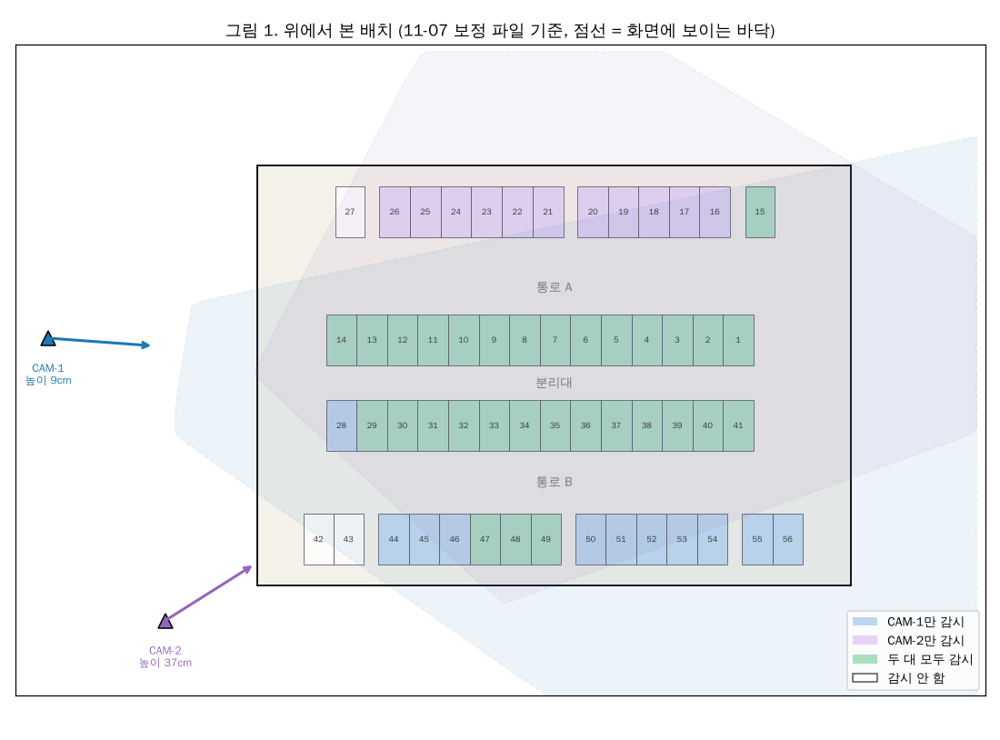

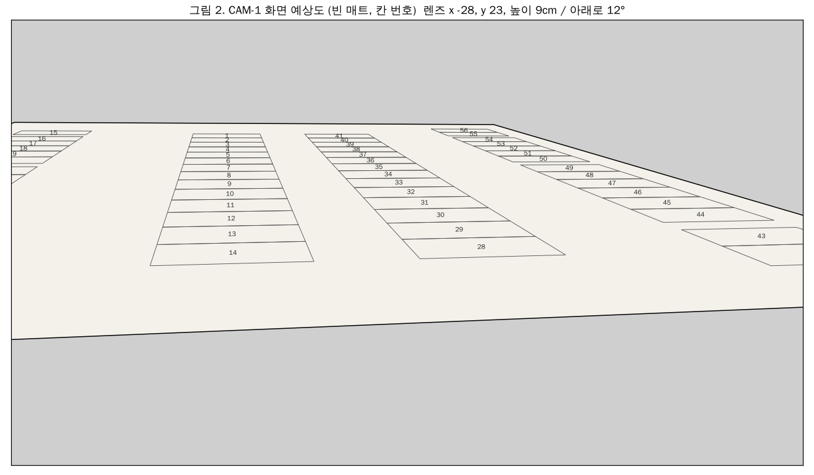

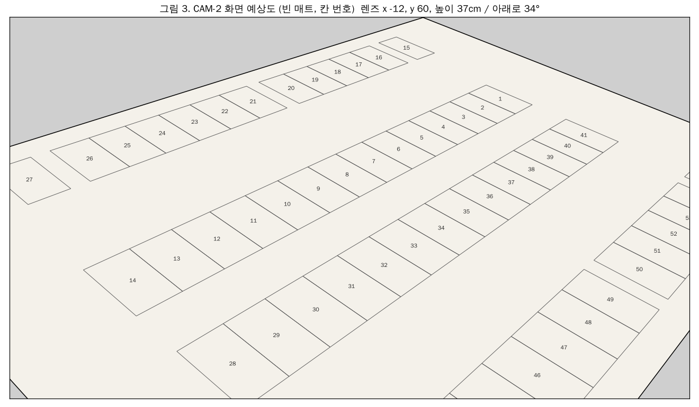

- CAM-1이 낮아(8.9cm) 1~14번 줄이 화면에서 아주 납작하게 겹쳐 보인다. 앞 칸 차가 뒤 칸을 가리기 쉬운 배치다.
- 상황 그림은 세 칸이다: 왼쪽 위에서 본 모습, 가운데 카메라 화면 전체(파란 네모가 확대 영역), 오른쪽 확대. 초록 칸은 판정 "차 있음", 주황 칸은 "가려짐(모름)", 빨간 테두리는 빈 칸↔차 있음이 뒤바뀐 칸, 노란 점선은 YOLO 상자(예상), 노란 점은 바닥 접점이다.

## 1. 한눈에 보기

| # | 상황 | v4 (11-04 보정) | v5 (11-07 보정, run.json) | 상태 |
|---|---|---|---|---|
| A1 | 차가 앞 칸 차에 완전히 가려 상자가 안 나옴 | 빈 칸(EMPTY)으로 안내 | **"가려짐(모름)"** (CAM-1 36/36, CAM-2 28/28) | **해결** (단 2대 설정은 아래 N2) |
| A4 | YOLO가 붙어 선 두 차를 상자 하나로 합침 | 한 칸 놓침 (CAM-1 25/25, CAM-2 20/36) | 놓친 칸이 "가려짐"이 됨 (0/36, 0/36) | **대부분 해결** (A1과 같은 수정 덕분) |
| A6 | 입구로 튀어나온 차 | 통로 차가 되어 칸이 "모름" | 같음 (빈 칸 판정 0) | 큰 문제 아님, 본문에서 뺌 |
| A2 | 통로에 멈춘 차를 칸 차로 판정 | 빈 칸 → 차 있음 | CAM-2 그대로 (30곳 중 8 / 28 / 26곳), 새 CAM-1은 거의 없음 (1곳) | **남음** |
| A3 | 이웃 두 차 중 뒤차가 "아래 잘린 상자" | 뒤차와 옆 빈 칸이 "모름" | 그대로 (CAM-1 36쌍 중 29쌍, CAM-2 7쌍) | **남음** |
| A5 | 걸침(P3)이 차 폭·방향을 고정해 둠 | 가로 주차를 거의 못 잡음 | 그대로 (가로 3칸 0%) | **남음** (11-07 hun 의견으로 고쳐 씀: 기준 0.1은 맞고, 방향 추정이 필요) |
| N1 | 칸에 선 차가 뒤의 빈 칸을 가림 | 없음 | 빈 칸이 "모름" (차 한 대당 CAM-1 평균 1.05칸, CAM-2 0.64칸) | **v5에서 새로 생김** |
| N2 | 2대 설정에는 칸 차 가림 기준이 0.9 | — | `run_2대.json`에서 A1이 다시 빈 칸 (CAM-1 36 중 23, CAM-2 28 중 26) | **v5에서 새로 생김** (설정) |
| B1~B8 | 방향과 상관없는 것 | | | 4절 |

계산에서 **문제없던 것** (v5, 두 카메라 모두):
- 차 한 대만 칸에 섬: 차 크기 2.8~3.6cm, 칸 안 좌우 ±1cm, 깊이 0/0.5cm를 바꿔도 차가 선 칸은 모두 맞게 골랐다(CAM-1 756개, CAM-2 756개). 옆 칸까지 막았는지(걸침)는 A5에서 따로 본다.
- 높이 3~4.5cm 차가 칸 바로 앞 통로에 섬(칸에도 차 있음): 모두 맞음.

## 2. 남은 문제

### A2. 통로 차를 칸 차로 판정 (대각선 CAM-2)

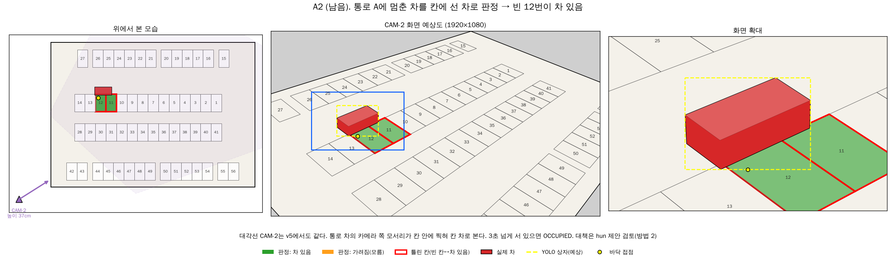

- **계산 결과 (차를 통로 방향으로 눕혀 x 10~68cm를 2cm씩 옮김, 30곳):**

| 카메라 | 통로 A 가운데 (y 16.1) | 통로 A 칸 쪽 (y 18.5) | 중앙 분리대 위 (y 28.7) | 통로 B 가운데 |
|---|---|---|---|---|
| CAM-2 (대각선) | 8 | 28 | 26 | 0 |
| CAM-1 (11-07, 줄 끝 낮게) | 0 | 1 | 0 | 0 |

- **왜 틀리나:**
  - 대각선에서 상자 아래 변 가운데는 차의 **카메라 쪽 모서리** 근처다. 통로 차는 칸 차와 방향이 90° 달라서, 그 점이 칸 안(입구 근처)에 찍힌다.
  - 칸을 고르는 함수 `_assign()`(P2)은 예상 접점과의 거리를 **줄 방향(x)으로만** 잰다. 깊이(y)는 판정 구역(칸 + 앞뒤 1cm)에 들어가기만 하면 통과다.
  - 통로에 3초 넘게 서 있으면(기다리는 차, 시연에서 손으로 멈춘 차) **OCCUPIED**가 된다.
  - 2대일 때 카메라 합치기(P9)는 "하나라도 차 있음이면 차 있음"이라, CAM-2의 이 오판이 CAM-1의 맞는 판정을 이긴다.
- **대책:** 칸을 고를 때 **깊이도 예상 접점과 비교**한다(아래 hun 제안 검토, 방법 2). 2대일 때 두 카메라가 다르게 말하면 그 칸을 더 정면에 가깝게 보는 카메라를 믿는 규칙도 생각할 수 있다.

#### hun 제안 검토 (11-07): 카메라에서 먼 쪽으로는 판정 범위를 늘리지 않기

**생각:** 바닥 접점은 상자 아래 변이라 차에서 **카메라에 가장 가까운 쪽**이다. 칸에 바르게 선 차의 접점이 칸의 먼 쪽 변 너머로 갈 일은 없다. 그러면 먼 쪽으로 판정 범위를 늘릴 필요가 없다.

- **방법 1 (제안 그대로):** 칸의 먼 쪽 변은 늘리지 않고 가까운 쪽 변만 1cm 늘린다. 대각선이면 카메라 방향 각도에 따라 먼 쪽 여유를 줄인다.
- **방법 2 (같은 생각을 예상 접점에 적용):** 칸 변 대신 예상 접점(P2b)을 기준으로 깊이도 본다. 접점이 예상 접점보다 카메라에서 먼 쪽으로 1.5cm, 가까운 쪽으로 2.0cm 넘게 떨어지면 그 칸이 아니다.

**그림.** 위 줄은 도면, 아래 줄은 카메라 화면이다. 왼쪽부터 지금 / 방법 1 / 방법 2. 점선 칸은 "이 칸의 차로 인정하는 접점 범위", ×는 그 칸의 예상 접점, 노란 점은 실제 바닥 접점이다.

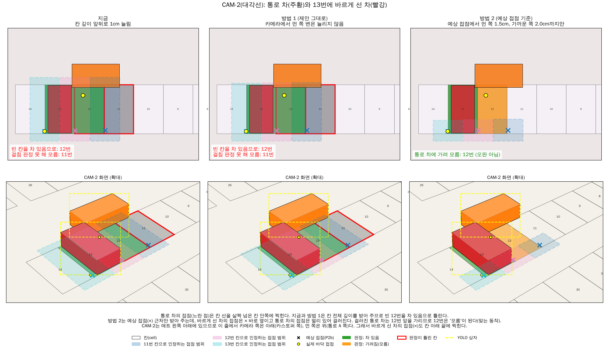

**결과 (v5 코드, 11-07 보정, 코드는 고치지 않고 계산 스크립트에서만 바꿈):**

| 시험 | 지금 | 방법 1 | 방법 2 |
|---|---|---|---|
| CAM-2 통로 A 가운데 차 → 칸 차로 오판 (30곳 중) | 8 | **0** | **0** |
| CAM-2 통로 A 칸 쪽 차 | 28 | 28 | **0** |
| CAM-2 분리대 위 차 | 26 | 26 | **0** |
| CAM-1 통로 A 칸 쪽 차 | 1 | — | **0** |
| 칸에 선 차, 이웃 두 차, 높은 차 가림, 튀어나온 차 | — | — | 지금과 같음(나빠진 것 없음) |

- **방법 1은 일부만 줄인다.** 대부분 통로 차의 카메라 쪽 모서리가 칸 여유가 아니라 **칸 안**에 찍히기 때문이다. 측면 카메라에서는 칸의 위·아래 변이 카메라와 같은 거리라 "먼 쪽 변"이 없어서 지금과 같다.
- **방법 2는 A2를 모두 없앴다.** 바르게 선 차의 접점은 칸 안에서도 예상 접점(×) 바로 옆에 찍히고, 통로 차의 접점은 ×에서 멀다. 카메라 각도는 예상 접점에 이미 들어 있어서 대각선 비율을 따로 계산할 필요가 없다.
- 허용 거리(1.5cm, 2.0cm)는 이번 계산으로 고른 첫 값이다. 좁히면(1.0/1.5) 튀어나온 차를 더 많이 통로 차로 봤다. 설정 숫자로 두고 실제 웹캠으로 맞춘다.
- 쓰려면 `_assign()`을 바꿔야 한다. 규칙대로 새 폴더(occupancy_v6)에서 한다.

### A3. 이웃 두 차 중 뒤차가 "아래가 잘린 상자" → 뒤차와 옆 빈 칸이 "모름"

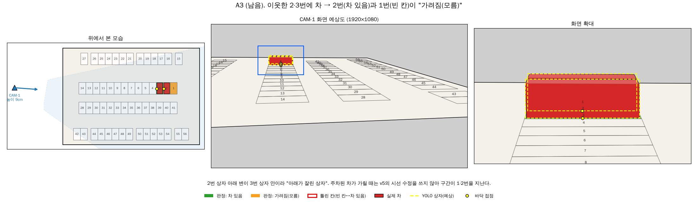

- **계산 (이웃한 두 칸에 보통 차):** CAM-1 36쌍 중 29쌍, CAM-2 36쌍 중 7쌍에서 뒤차 칸과 그 너머 빈 칸 하나가 "가려짐"이 된다. 빈 칸을 차 있음으로 보거나 차를 놓친 경우는 0이다.
- **왜:** 뒤차 상자의 아래 변이 앞차 상자 안에 들어가서 "아래가 잘린 상자"(P2a)가 된다. 구간 "앞차 뒤 끝 ~ 뒤차 접점"은 카메라 반대 방향(`far_dir`)으로 뻗는데, 측면에서는 이 방향이 **줄 방향**이라 두 칸을 지난다. 앞차 뒤 끝을 차 길이(6.5cm)로 잡는데, 측면에서 시선 방향 차 길이는 차 폭(3.2cm)에 가까워 더 넘어간다.
  - v5의 시선 수정(`_sight_start()`)은 **가리는 차가 통로 차일 때만** 쓴다. 칸에 선 차가 가릴 때 쓰면 대각선에서 나빠져서(38 문서 2절) 이 경우는 그대로다.
- **영향:** 차 있음을 빈 칸으로 안내하지는 않는다. 하지만 두 차가 서 있는 내내 뒤차 칸과 그 너머 빈 칸이 "모름"이다. 새 CAM-1은 낮아서 뒤차가 거의 다 가려지는데(그림), 그때 YOLO가 놓치면 A1 경우(가려짐)로 넘어간다.
- **대책 후보:**
  1. 가리는 차가 칸 차일 때 뒤 끝 깊이를 고정 6.5cm 대신 **시선 방향으로 본 차 길이**(|폭 × sin| + |길이 × cos|)로 쓴다.
  2. 구간이 여러 칸을 지나도, 잘린 상자의 **가로 범위(화면 x)가 한 칸의 예상 상자와 잘 맞으면** 그 칸으로 정한다.
  3. 2대일 때는 반대쪽 카메라가 가려지지 않으면 카메라 합치기(P9)로 풀린다.

### A5. 걸침(P3): 비켜 선 차와 가로 주차 (11-07 hun 의견 반영해 고쳐 씀)

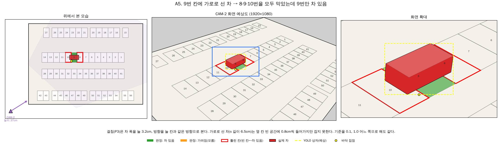

**기준을 어떻게 볼까 (hun):** 옆 칸 주차선을 밟거나 넘은 차가 있으면 그 칸은 실제로 주차하기 어렵다. 가로로 2칸, 3칸을 막은 차는 막은 칸 모두 "차 있음"이어야 한다. 그래서 `run.json`은 0.1로 실험했다.
- 이 기준이면 0.1은 맞는 값이다. "차 옆면이 칸 선을 넘어 옆 칸 빈 공간(inner)에 0.1cm라도 들어가면 막힘"이라는 뜻이다. 처음에 "1cm 비켜 서도 옆 칸 차 있음은 오판"이라고 쓴 것은 "칸 선을 넘어도 옆 칸은 빈 칸"이라는 다른 기준으로 센 것이라 고쳤다.
- 3.2cm 차가 빈 공간 3.1cm 칸에 서면 좌우 여유가 없다. 1cm만 비켜도 칸 선(약 0.9cm)을 넘어 옆 칸 빈 공간에 0.14cm 들어간다. 같은 크기 차는 그 옆 칸에 선을 넘지 않고는 못 선다.

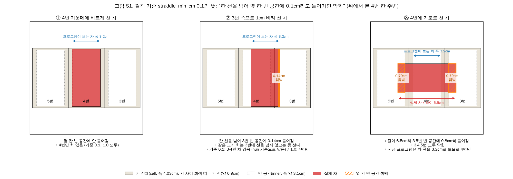

**진짜 문제는 기준값이 아니라 차 폭과 방향을 고정해 둔 것이다.** 걸침 규칙은 차 폭을 늘 3.2cm, 방향을 늘 "칸과 같은 방향"으로 본다.
- 실제 차 폭이 2.8이나 3.6cm면 경계에서 틀린다.
- **가로 주차는 거의 못 잡는다.** 가로로 선 차는 x 방향 길이가 6.5cm인데 3.2cm로 계산하고, 바닥 접점도 한쪽 끝으로 쏠려 칸 자체를 옆 칸으로 고르기도 한다.

**합성 계산 (v5, 11-07 보정)**

표 읽는 법 (아래 그림 S3):
- 칸마다 차를 여러 위치에 놓아 보았다. ① 바르게 선 차 15가지(차 폭 3가지 × 좌우 위치 5가지), ② 두 칸 사이에 가로로 선 차 9가지, ③ 칸 가운데에 가로로 선 차(3칸을 막음) 5가지. 이것을 1~14번·28~41번 줄에서 카메라가 감시하는 칸마다 반복했다(양 끝 칸 제외, CAM-1 24칸, CAM-2 23칸).
- **정답**은 실제 차가 빈 공간(inner)에 0.1cm 이상 들어간 칸 모두다. 프로그램이 "차 있음"으로 낸 칸들이 정답과 **정확히 같으면 맞음**, 하나라도 더하거나 빠지면 틀림이다.
- 표의 숫자는 **cm나 픽셀이 아니라 경우의 수**다. "310 / 360"은 360가지 위치 중 310가지에서 맞았다는 뜻이다.

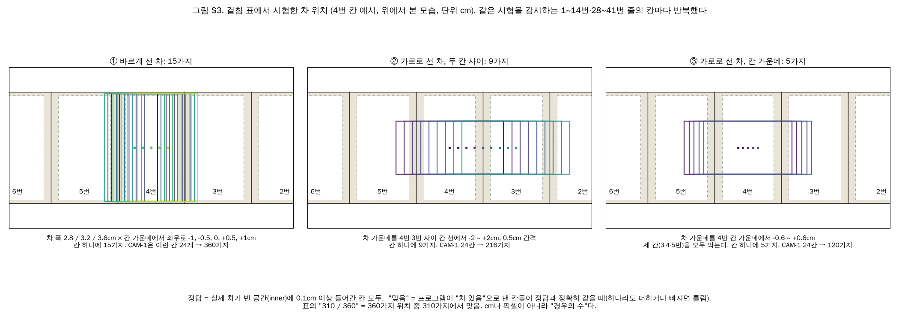

| 방법 (맞은 경우 / 시험한 경우) | CAM-1 ① 바르게 선 차 | CAM-1 ② 가로 2칸 | CAM-1 ③ 가로 3칸 | CAM-2 ① 바르게 선 차 | CAM-2 ② 가로 2칸 | CAM-2 ③ 가로 3칸 |
|---|---|---|---|---|---|---|
| 지금, 기준 0.1 | 310 / 360 | 38 / 216 | 0 / 120 | 285 / 345 | 94 / 207 | 0 / 115 |
| 지금, 기준 1.0 | 264 / 360 | 0 / 216 | 0 / 120 | 253 / 345 | 8 / 207 | 0 / 115 |
| **방향 추정 + 기준 0.1** | 310 / 360 | **216 / 216** | **120 / 120** | 269 / 345 | **207 / 207** | **115 / 115** |

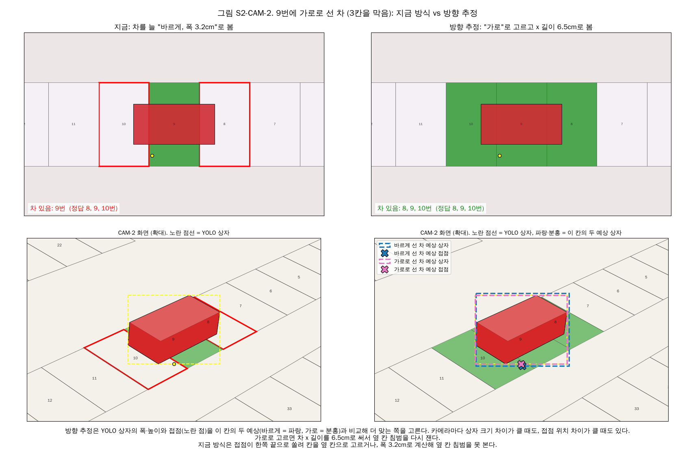

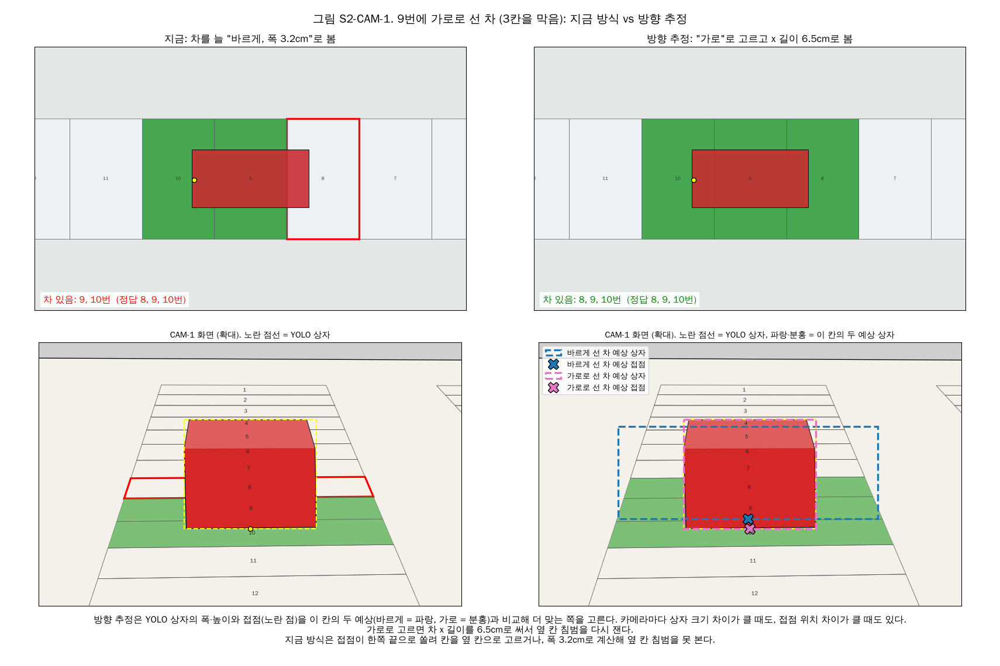

- **방향 추정:** 칸마다 "바르게 선 차"와 "가로로 선 차"의 예상 상자와 예상 접점을 미리 계산해 둔다(P2b와 같은 방법). YOLO 상자의 크기(폭·높이)와 접점이 어느 쪽에 더 맞는지로 칸과 방향을 함께 고른다. 가로면 x 방향 길이를 6.5cm로 쓴다. 방향은 CAM-1 696개 중 696개, CAM-2 667개 중 639개 맞혔다.
- 바르게 선 차가 남는 오류(약 15%)는 실제 차 폭이 3.2cm와 달라 경계에서 생긴다. 시연 차 폭을 재서 `car_width_cm`에 넣으면 줄어든다.
- 가로 주차를 잡으려면 기준 1.0은 안 된다. **기준은 0.1로 두고, 방향 추정을 넣는 쪽을 권한다.**
- 한계: 합성 상자는 차 모양에 꼭 맞는다. 실제 YOLO 상자는 크기가 흔들려 방향을 잘못 고를 수 있다. 판정 프로그램 전체(잘린 상자 등)에는 아직 넣어 보지 않았다. 넣으려면 occupancy_v6에서 한다.

#### A5-2. 비스듬히(대각선으로) 선 차 (11-07 hun 질문)

위의 방향 추정은 차가 "바르게(0°)" 아니면 "가로(90°)"로만 선다고 본다. 실제로는 10~30°쯤 틀어서 세우거나 더 비스듬히 세울 수 있다.

**지금 코드는 비스듬히 선 차를 거의 놓친다.** 걸침(P3)이 차 폭 3.2cm, 칸과 같은 방향으로만 계산하기 때문이다. 비스듬히 선 차는 앞뒤 모서리가 옆 칸으로 나가도 그 칸을 "차 있음"으로 내지 않는다(그림 S5의 빨간 막대).

**어려운 점: YOLO 상자는 숫자 4개뿐이다.** 상자(왼·위·오른·아래)로는 차의 위치, 각도, 크기를 다 알 수 없다. 특히 오른쪽으로 20° 돌린 차와 왼쪽으로 20° 돌린 차는 화면에서 거의 같은 상자가 된다. 그런데 둘이 막는 옆 칸은 다르다(그림 S4에서 빨강은 8번 위·10번 아래, 파랑은 10번 위·8번 아래를 침범). 줄을 따라 낮게 보는 CAM-1은 두 상자 차이가 2픽셀 정도라 구별할 수 없다. 대각선 CAM-2는 10~25픽셀 차이가 나서 구별이 된다.

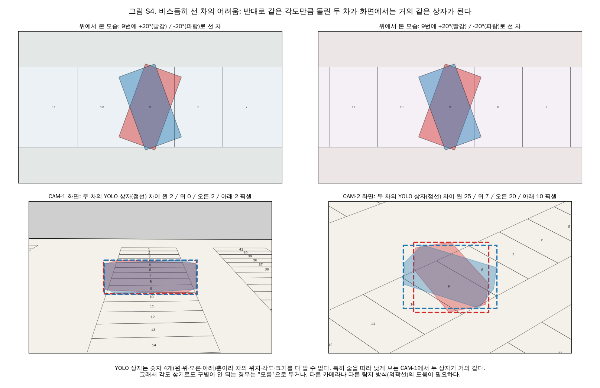

**대응 방법**

1. **각도 찾기 (방향 추정을 넓힘).** 바르게/가로 두 가지 대신, 칸마다 -85°~90°를 5° 간격(36가지)으로 돌린 차의 예상 상자와 예상 접점을 보정 때 미리 계산해 둔다. YOLO 상자에 가장 잘 맞는 칸·각도를 고르고, 그 각도로 놓인 차의 바닥 모양(사각형)이 옆 칸 빈 공간(inner)에 0.1cm 이상 들어가면 "차 있음"으로 낸다.
   - **구별이 안 되면 "모름".** 거의 똑같이 잘 맞는 후보(+20°와 -20° 같은)가 서로 다른 칸을 막는다면, 결과가 갈리는 칸만 "모름"으로 둔다. 틀린 답을 내는 대신 모른다고 하는 것이다.
2. **두 카메라 합치기.** CAM-1에서 구별이 안 되는 각도도 다른 방향의 CAM-2에서는 구별된다. 카메라 합치기(P9)처럼 "한 카메라라도 확실히 차 있음이면 차 있음, 두 카메라 모두 모름일 때만 모름"으로 합친다. 최종 시연이 2대이니 이 방법이 가장 효과가 크다.
3. **차 외곽선을 주는 모델.** YOLO의 분할(seg)이나 회전 상자(OBB) 모델은 상자 4개 숫자 대신 차의 윤곽이나 돌아간 각도를 준다. 그러면 바닥 모양을 바로 그릴 수 있어 1번의 추측이 필요 없다. 대신 사진을 다시 라벨링하고 학습해야 한다(지금 라벨은 상자뿐).
4. **시연 운영 규칙.** 위 방법을 다 넣기 어렵다면, 시연에서는 차를 바르게 또는 가로로만 세운다고 정해 두는 것도 방법이다.

**합성 계산 (v5, 11-07 보정, 그림 S5)**
- 두 카메라가 모두 감시하는 31칸(양 끝 제외)에서 칸마다 각도 14가지(0°, ±10°, ±20°, ±30°, ±45°, ±60°, ±75°, 90°) × 좌우 위치 3가지(-0.8, 0, +0.8cm)로 차를 놓았다. 정답은 A5 표와 같다(차가 빈 공간에 0.1cm 이상 들어간 칸 모두).
- 숫자는 **경우의 수**다. "맞음"은 정답과 정확히 같은 경우, "모름"은 틀린 칸은 없지만 일부 칸을 모름으로 둔 경우다.

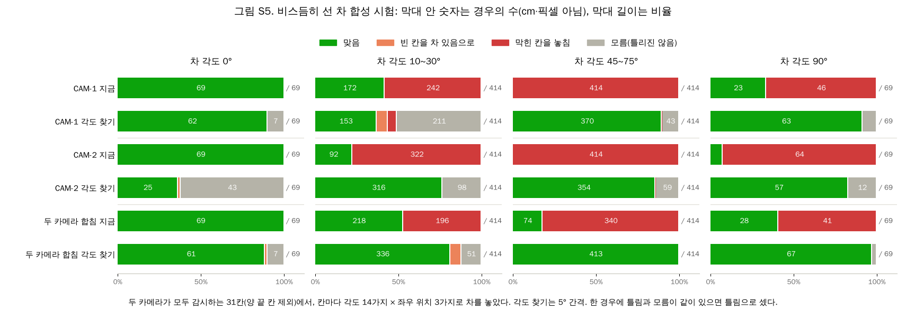

| 차 각도 (맞음 / 시험한 경우) | 0° | 10~30° | 45~75° | 90° |
|---|---|---|---|---|
| CAM-1 지금 | 69 / 69 | 172 / 414 | 0 / 414 | 23 / 69 |
| CAM-1 각도 찾기 | 62 / 69 (모름 7) | 153 / 414 (모름 211, 틀림 50) | 370 / 414 (모름 43) | 63 / 69 (모름 6) |
| CAM-2 지금 | 69 / 69 | 92 / 414 | 0 / 414 | 5 / 69 |
| CAM-2 각도 찾기 | 25 / 69 (모름 43) | 316 / 414 (모름 98) | 354 / 414 (모름 59) | 57 / 69 (모름 12) |
| **두 카메라 합침 + 각도 찾기** | 61 / 69 (모름 7) | **336 / 414** (모름 51, 틀림 27) | **413 / 414** | **67 / 69** |

- **지금 코드는 45~75°로 선 차를 한 번도 맞히지 못한다**(모두 옆 칸을 놓침). 각도 찾기를 넣으면 놓침이 거의 없어지고, 대신 "모름"이 생긴다.
- **두 카메라를 합치면 "모름"이 크게 준다.** 45~75°는 414가지 중 413가지가 맞는다.
- **남는 약점은 CAM-1의 작은 각도(10~30°)다.** +θ와 -θ가 구별이 안 되어 모름이 많고(211), 27가지는 빈 칸을 차 있음으로 낸다. 이 27가지는 두 카메라를 합쳐도 남는다(CAM-1이 "확실히 차 있음"이라고 잘못 내기 때문). "한 카메라는 차 있음, 다른 카메라는 확실히 빈 칸이면 모름"으로 합치면 17가지로 줄지만 모름이 51에서 84로 는다.
- CAM-2의 0°에서 모름이 43가지 나오는 것은, 대각선 카메라에서 0°와 ±10° 차의 상자가 비슷하기 때문이다. 바르게 선 차를 모름으로 두는 것이 거슬리면, 각도 찾기를 0°·90°에 가까운 경우에는 바르게/가로를 우선하도록 조정할 수 있다.
- **"모름" 없이 늘 하나로 고르면**(각도 찾기에서 가장 잘 맞는 하나만 씀): CAM-1 10~30°는 432가지 중 271가지 맞음, 빈 칸→차 있음 95, 놓침 66. 틀린 답이 많아지므로 모름을 두는 쪽을 권한다.
- 한계: A5 표와 같다. 합성 상자는 차 모양에 꼭 맞는다. 실제 YOLO 상자는 몇 픽셀씩 흔들리므로, CAM-2에서도 +θ/-θ 구별(10~25픽셀 차이)이 실제로 되는지는 웹캠으로 확인해야 한다. 각도 찾기는 칸마다 36가지 예상 상자를 보정 때 한 번 계산해 두면 되므로, 판정할 때 계산이 많이 늘지는 않는다.

## 3. v5에서 새로 생긴 문제

### N1. 칸에 선 차가 뒤의 빈 칸을 "모름"으로 만듦

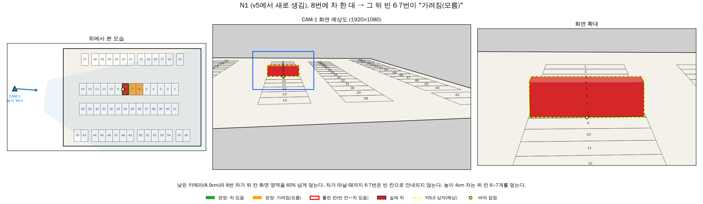

- **무엇:** v5는 칸에 선 차도 가리는 차로 센다(덮임 60% 이상, `run.json`의 `occlusion_ratio_parked` 0.6). 그래서 차가 서 있는 동안 그 뒤의 빈 칸이 "가려짐 → 1초 뒤 DYNAMIC_BLIND"가 된다.
- **계산:** 빈 매트에 차 한 대를 칸마다 세웠을 때 다른 빈 칸이 "모름"이 된 수
  - CAM-1(8.9cm): 평균 1.05칸, 칸 6~10번 차는 뒤 2칸
  - CAM-2(36.8cm): 평균 0.64칸
  - 높이 4cm 차(승합·트럭)가 서면 CAM-1에서 뒤 칸 **6~8개**가 "모름"이 된다(아래 그림). 같은 그림이 A1이 해결된 모습이기도 하다: 완전히 가린 8번이 빈 칸이 아니라 "모름"이다.

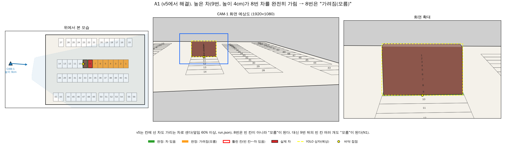
- **판단:** 화면에서 실제로 덮인 칸이라 "모름"은 맞는 말이다. 하지만 1대 시연에서는 빈 칸으로 안내할 수 있는 칸이 줄어든다. 38 문서 4절에서 "잘못 가려짐이 되면 차가 떠날 때까지 그 칸의 빈자리를 알 수 없다"고 적은 것과 같은 문제다.
- **대책 후보:**
  1. 카메라를 조금 높인다. 15cm 정면 배치에서는 0.6 기준으로도 0%였다(38 문서 4절 표).
  2. 직전 상태가 OCCUPIED였던 칸만 칸 차 가림으로 "가려짐"을 주고, EMPTY였던 칸은 그대로 판정한다(가려진 뒤 차가 들어오면 놓칠 수 있는 대신 빈 칸 안내는 유지).
  3. 2대로 서로 다른 쪽에서 보게 해서 카메라 합치기(P9)로 푼다.

### N2. 2대 설정(`run_2대.json`)에는 칸 차 가림 기준이 0.9

- `run_2대.json`에는 `occlusion_ratio_parked`가 없어서 기본값 0.9를 쓴다. 이 값에서는 A1(앞차에 완전히 가린 차)이 다시 **빈 칸**이 된다: CAM-1 36 중 23, CAM-2 28 중 26.
- 2대에서 다른 카메라가 그 칸을 보면 P9로 풀리지만, 두 카메라 모두 가려지면 빈 칸으로 안내한다.
- **대책:** 2대 시연 전에 `run_2대.json`에도 값을 정해 적는다(0.6이면 N1이 생기므로 둘을 같이 보고 정한다).

## 4. 방향과 상관없이 틀릴 수 있는 것

| # | 상황 | 왜 | 결과 | 대책 |
|---|---|---|---|---|
| B1 | 통로 차가 칸 앞을 가려 칸 차를 놓침 | 통로 차 가림 기준 30%(P5)는 정면 배치로 계산한 값(26 문서 3.3절). 측면·대각선은 칸 화면 영역 모양이 다르다 | 덮임이 30% 아래면 EMPTY | 지금 카메라 자세로 비율을 다시 보거나 실험(S4)으로 줄별 값을 정한다 |
| B2 | 물체 오탐(M8 T7 사진에서 2개), 손, 그림자 | 칸 안에 상자가 생기면 차로 본다 | 3초 뒤 OCCUPIED | `conf` 0.25 → 0.4(21 문서), 시연 중 손이 들어가지 않게 |
| B3 | 차 놓침(어두움, 반사, 흐림) | 상자가 없으면 차 없음 | 5초 뒤 EMPTY | 조명 고정, 초점 거리(11 문서 3절). 새 CAM-1은 먼 줄(42~56번)까지 감시하는데 그 칸들은 화면에서 아주 작다 |
| B4 | 높이 4cm 넘는 차가 통로에서 칸 차 아래를 가림 | 잘린 상자 접점이 뒷줄로 밀림(26 문서 1.6절) | 뒷줄 빈 칸 차 있음 | v5 시선 수정과 P2a가 맡음. 이번 계산(3~4.5cm)에서는 맞았다 |
| B5 | 화면 끝에 잘린 상자 | 아래 변이 화면 끝이라 접점이 실제와 다름. 화면 끝에 닿은 상자(`edge`)라도 걸침(P3)만 안 할 뿐 칸 판정은 그대로 한다 | 엉뚱한 칸이나 통로 | 가장자리 상자는 칸 판정에서 빼고 "모름"으로 두기 |
| B6 | 카메라가 밀리거나 보정이 어긋남 | 재투영 오차 평균 8.6~9.7px, 최대 13~16px. 줄마다 깊이 0.2~0.5cm 어긋남(34 문서). 새 CAM-1은 낮아서 같은 픽셀 오차가 먼 칸에서 큰 cm 오차가 된다 | 여유(가로 2cm, 깊이 1cm)가 줄어 A2가 더 잘 생김 | 보정 때 화각 자동 추정(F 키), 켤 때 칸 선 겹쳐 확인, ver2 기준점 자동 찾기로 밀림 감지 |
| B7 | 기본 크기와 다른 차(트럭, 버스 모형) | 예상 접점은 3.2 × 6.5 × 2cm 차 하나로 계산. 칸 차 가림(N1)도 높은 차일수록 넓다 | 대각선일수록 접점이 더 밀림 | 시연 차를 정해 두고 그 크기로 확인 |
| B8 | 두 카메라 의견이 다름 | 카메라 합치기(P9): 가려지지 않은 카메라 중 하나라도 차 있음이면 차 있음 | 한 카메라 오판(A2)이 그대로 나옴 | A2 대책 |

## 5. 무엇부터 할까 (제안)

1. **A5**는 기준 0.1을 그대로 두고, 걸침에 각도 찾기(바르게·가로·비스듬히, 5° 간격, 구별 안 되면 모름)를 넣는다. 가로 2·3칸 주차와 비스듬히 선 차를 잡는다. 2대 시연에서는 두 카메라 합치기로 모름을 줄인다.
2. **N2**: 2대 시연 전에 `run_2대.json`의 `occlusion_ratio_parked`를 정한다. N1과 같이 실험해서 정한다. `run_2대.json`의 `straddle_min_cm`(1.0)도 0.1로 맞출지 같이 정한다.
3. **A2**는 방법 2(예상 접점 기준 깊이 비교)를 occupancy_v6에 넣는다. 계산으로는 다른 경우를 나쁘게 하지 않았다.
4. **A3**는 측면 카메라에서 "모름"이 많아지는 문제다. 실험에서 얼마나 거슬리는지 보고 대책 1·2를 정한다.
5. 실제 웹캠 실험 목록: 이웃 칸 두 대(높이 2cm·4cm), 한 줄 꽉 채움, 통로 A 칸 쪽에 3초 넘게 정지(CAM-2), 차 한 대 뒤 빈 칸이 "모름"이 되는지(CAM-1), 붙어 선 두 차의 YOLO 상자 확인.

## 6. 그림 다시 그리기

`docs\그림\39\make_fig_base.py`, `make_fig_cases.py`, `make_fig_zone.py`. 비스듬히 선 차는 `test_straddle_angle.py`(합성 시험), `make_fig_angle.py`(그림 S4), `make_fig_angle_result.py`(그림 S5). occupancy_v5 코드와 설정을 읽어 그린다(경로는 파일 맨 위에서 고친다).
